# Anti-trace

[中文](README.md) | **English**

Anti-trace is an AI coding agent that runs in your terminal. It can read and edit code, execute shell commands, find project files, and decide what to do next based on the results. Bring your own API credentials to connect a model provider through OpenAI Chat Completions, OpenAI Responses, or Anthropic Messages.



## What it can do

- **Understand a project:** read source files, trace module relationships, and explain code.
- **Write and change code:** implement features, fix bugs, refactor code, or write documentation from your instructions.
- **Run development tasks:** use the shell to find files, run builds and tests, and investigate problems using command output.
- **Continue previous work:** save project conversations and restore them with `/resume`; track context usage and compact conversation history.
- **Work with text and images:** multiline editing, long-text pasting, image input, and draft undo/redo.

## Quick start

You need Node.js 22 or newer and API credentials for your chosen model provider.

```sh
git clone https://github.com/sadgsk/Anti-trace.git
cd Anti-trace
npm install
```

Copy [byok.example.json](byok.example.json) to `byok.json` in the project root and configure:

- The connection's API key and service URL.
- The model ID, context window, and output limit.
- `currentModel`: the model configuration key to use.

The default `main` entry contains a placeholder URL and model ID. Replace them before making a model request. Then start the CLI:

```sh
npm start
```

Describe a task directly in the conversation, for example:

```text
Explain this project's entry points and main modules.
Fix this function's handling of empty input and add a test.
Run the build, investigate the errors, and update the relevant code.
```

The agent reads files, edits code, and runs commands as needed. These actions affect your project files directly; use a recoverable copy for initial evaluation.

## Model providers

Use BYOK JSON to configure your own model service:

| API | Configuration value |
|---|---|
| OpenAI Chat Completions | `openai-completions` |
| OpenAI Responses | `openai-responses` |
| Anthropic Messages | `anthropic-messages` |

Models reference a connection through `connection`; `currentModel` selects a key in `models`. Set `apiKey` directly or use `apiKeyEnv` to reference a process environment variable.

The CLI remembers the last successfully used configuration and model for each project and restores them on restart. On first launch, it reads `byok.json` from the startup working directory. If there is neither a remembered selection nor a root `byok.json`, it automatically uses the sole valid configuration in `.ant-trace/configs/`; use `/config` to choose when there are several. `CLI_AGENT_CONFIG` overrides the remembered configuration. The selection is stored in `.ant-trace/last-model.json`, containing only the configuration path and model key. `.env` files are not loaded. `byok.json` and `.ant-trace/` are ignored by Git; do not commit real credentials.

Anthropic Messages defaults to `32000` when `maxOutputTokens` is omitted, capped at the configured `contextWindow` if it is smaller. An explicit output limit takes precedence.

Include any required version prefix in `baseUrl`, such as `/v1`. Alternatively, select connection presets and models from the [provider configuration example](byok.providers.example.json), then set the corresponding API key environment variables. The example includes 36 connection options across nine providers, with explicit rules for supported protocols, regions, and models.

## Common commands

Type `/` to open the command menu; use arrows to select, Enter to confirm, Tab to complete and Esc to return. Model, effort, thinking, thinking display, session resume and configuration commands open selection screens without typed arguments. Explicit arguments remain compatible. Input starts at the bottom; use the mouse wheel or PgUp/PgDn to review history, Ctrl+End to return to the latest output, and Shift+drag to select text.

| Command | Purpose |
|---|---|
| `/help` | Show help |
| `/new` | Start a new session |
| `/resume` | Select and restore a session with arrow keys |
| `/model` | Select from models in the current configuration |
| `/config` | Choose, add or edit configurations; add models to one file and edit each field on a separate page |
| `/reload` | Reload model configuration |
| `/thinking` | Select reasoning on/off |
| `/effort` | Select low/medium/high/xhigh/max with arrow keys |
| `/thinking-display` | Select the default reasoning text visibility |
| `/language` | Switch between Chinese and English and remember the preference |
| `/context [positive integer]` | View or adjust the context window |
| `/compact` | Attempt manual context compaction |
| `/exit` | Exit |

The complete TUI is ready for trial; see the [architecture and interaction notes](docs/architecture.md#4-分层) and [progress record](docs/progress.md) for validation and remaining work. It includes Markdown, code and tables, tool cards and diffs, permission approval, file completion with `@`, and attachment indicators. Ctrl+O expands/collapses content at the current reading position, or opens the latest tool when following live output; Shift+Tab cycles permission modes. Use `npm start -- --auto-edit` or `npm start -- --yolo` to choose a startup mode explicitly.

Enter submits. Shift/Alt+Enter, or a backslash followed by Enter, inserts a newline. Ctrl+C interrupts generation or clears the draft; when idle with an empty draft, it exits. Ctrl+Z undoes; Ctrl+Y redoes. Shortcut recognition depends on the terminal.

`/reload` reloads model configuration while preserving the current model selection and reasoning preferences. `/new` inherits the current settings; `/resume` resolves saved model references against the loaded catalog. The reasoning display switch only affects display, not model requests.

## Project direction

The project is in early development. Its long-term goal is to let users describe a feature in natural language, have the agent modify its own tools or CLI interface, and apply those changes through a hot restart.

This capability has not been implemented. The diagram above shows the proposed design. Current work focuses on the underlying model integration, tool execution, sessions, and context management.

- [ ] Dynamically modify tools, the CLI interface, and other capabilities from natural-language requests.
- [ ] Validate capability changes and load them through a hot restart.
- [x] Provider presets, reasoning controls, and the unified settings workflow.
- [ ] Improve TUI interaction in v1.3.
- [ ] Establish reproducible automated tests and expand real-model and cross-platform verification.
- [ ] Fix recorded issues with tool pairing, Windows command execution, and context-overflow error display.

## Known limitations

- On Windows, the `bash` tool actually uses `cmd.exe`. Command failures and hangs are recorded in [future-issues.md](docs/future-issues.md).
- Premature display of recoverable context-overflow errors still needs work. Interrupted tool-batch pairing was fixed in the TUI implementation; see the [review records](docs/review-records.md).
- Local HTTP SSE and macOS POSIX PTY verification records exist. Coverage of real models, clipboards, and other terminal platforms remains incomplete.
- The repository does not yet provide a reproducible automated test suite. Use `npm run typecheck` for type checking and `npm run build` to build the project.

## Development documentation and origins

The detailed development documents are currently in Chinese.

- [Development progress](docs/progress.md): current status, pending work, and development history.
- [Architecture](docs/architecture.md): module responsibilities and design.
- [Main execution flow](docs/main-flow.md): input submission, model requests, tool execution, and event propagation.

The project started by studying and referencing [Pi](https://github.com/earendil-works/pi). Some foundational code was adapted from Pi. Anti-trace uses its own `Harness` and feature design, and does not currently depend on Pi runtime packages.

## License

[MIT](LICENSE). Portions derived from Pi retain their original copyright and license notice.
