# Anti-trace

**中文** | [English](README.en.md)

Anti-trace 是一个运行在终端里的 AI 编程 agent，可以帮你阅读和修改代码、执行 shell 命令、查找项目文件，并根据执行结果自主决定下一步动作。你可以使用自己的 API 密钥接入模型服务，目前支持 OpenAI Chat Completions、OpenAI Responses 和 Anthropic Messages 三种接口。



## 能做什么

- **理解项目**：阅读源码，梳理模块关系，解释代码逻辑。
- **编写和修改代码**：根据需求实现功能、修复 bug、重构代码或编写文档。
- **执行开发任务**：调用 shell 查找文件、运行构建和测试，并结合命令输出继续排查问题。
- **继续已有工作**：保存项目会话，通过 `/resume` 恢复对话；支持上下文用量显示和摘要压缩。
- **处理图文输入**：支持多行编辑、长文本粘贴、图片输入，以及草稿撤销和重做。

## 快速开始

需要 Node.js 22 或更新版本，以及所选模型服务的 API 密钥。

```sh
git clone https://github.com/sadgsk/Anti-trace.git
cd Anti-trace
npm install
```

将 [byok.example.json](byok.example.json) 复制为项目根目录的 `byok.json`，填写：

- 连接的 API key 和服务地址。
- 模型 ID、上下文窗口与输出上限。
- `currentModel`：要使用的模型配置键。

示例默认选择的 `main` 使用占位地址和模型 ID，需要替换后才能调用。配置完成后启动：

```sh
npm start
```

进入对话后，可以直接描述任务，例如：

```text
梳理这个项目的入口和主要模块。
修复这个函数对空输入的处理，并补上对应测试。
运行构建，分析报错并修改相关代码。
```

Agent 会按任务需要读取文件、修改代码和执行命令。这些操作会直接影响项目文件，首次试用建议使用可恢复的项目副本。

## 模型接入

通过 BYOK JSON 配置自己的模型服务：

| 接口 | 配置中的 api |
|---|---|
| OpenAI Chat Completions | `openai-completions` |
| OpenAI Responses | `openai-responses` |
| Anthropic Messages | `anthropic-messages` |

模型通过 `connection` 引用连接配置，`currentModel` 选择 `models` 中的模型键。连接可以直接填写 `apiKey`，也可以用 `apiKeyEnv` 引用进程环境变量。

CLI 默认读取启动目录下的 `byok.json`，也可通过 `CLI_AGENT_CONFIG` 指定其他文件。不会读取 `.env` 文件。`byok.json` 已被 Git 忽略，请勿提交真实密钥。

`baseUrl` 应包含服务所需的版本前缀，例如 `/v1`。也可从 [厂商配置示例](byok.providers.example.json) 选取连接预设与模型，设置对应的环境变量密钥。示例覆盖九家厂商的 36 个连接选项；各协议、地区和模型的参数按明确规则适配。

## 常用命令

交互界面默认收起命令列表。输入 `/` 打开命令菜单，继续输入可按名称前缀筛选；↑↓ 选择，Enter 确认，Tab 仅补全，Esc 收起并保留草稿。`/model` 需要继续填写模型键；有可选参数的命令可用 Tab 补入后填写参数，也可直接按原有语法输入完整命令。

| 命令 | 用途 |
|---|---|
| `/help` | 查看帮助 |
| `/new` | 开始新会话 |
| `/resume` | 列出会话，输入序号恢复 |
| `/model <模型键>` | 选择本次运行使用的模型 |
| `/config [路径]` | 查看配置状态或更换配置文件 |
| `/reload` | 重新读取模型配置 |
| `/thinking on\|off\|default` | 开启、关闭思考或使用服务端默认 |
| `/effort low\|medium\|high\|xhigh\|max` | 设置思考档位 |
| `/thinking-display on\|off` | 显示或隐藏思考内容 |
| `/context [正整数]` | 查看或调整上下文窗口 |
| `/compact` | 尝试手动压缩上下文 |
| `/exit` | 退出 |

Enter 提交，Shift/Alt+Enter 或反斜杠后 Enter 换行；Ctrl+C 中断生成或清空草稿，空闲且草稿为空时退出。Ctrl+Z 撤销，Ctrl+Y 重做。快捷键识别取决于终端。

`/reload` 重新读取模型配置，保留当前模型选择和思考偏好；`/new` 继承当前设置，`/resume` 从已加载目录解析会话保存的模型引用。思考显示开关只影响显示，不改变模型请求。

## 项目方向

项目目前处于早期开发阶段。长期目标是让用户用自然语言描述希望增加或修改的功能，由 agent 修改自身的工具、CLI 界面等能力，再通过热启动应用变更。

这项能力尚未实现，顶部架构图展示的是预计设计。当前先完善模型接入、工具执行、会话与上下文管理等基础能力。

- [ ] 根据自然语言需求动态修改工具、CLI 界面等功能。
- [ ] 验证功能变更，并通过热启动加载修改。
- [x] 厂商预设、思考控制与统一设置链路。
- [ ] 在 v1.3 完善 TUI 交互。
- [ ] 建立可复现的自动化测试，补充真实模型和跨平台验证。
- [ ] 修复已记录的工具配对、Windows 命令执行和上下文溢出提示问题。

## 已知限制

- Windows 上的 `bash` 工具实际使用 `cmd.exe`，存在命令执行失败和卡住的问题，见 [问题记录](docs/future-issues.md)。
- 中断后的工具配对，以及可恢复的上下文溢出错误提前显示问题仍待处理，见 [评审记录](docs/review-records.md)。
- 已有本地 HTTP SSE 和 macOS POSIX PTY 验证记录，真实模型、剪贴板和其他终端平台的覆盖仍不完整。
- 仓库尚未提供可复现的自动化测试套件。`npm run typecheck` 和 `npm run build` 可用于类型检查与构建。

## 开发文档与来源

- [开发进度](docs/progress.md)：当前状态、待办与开发记录。
- [架构书](docs/architecture.md)：模块职责与设计。
- [运行主流程](docs/main-flow.md)：输入提交、模型请求、工具执行与事件传播。

项目从阅读和参考 [Pi](https://github.com/earendil-works/pi) 起步，部分基础代码参考并改写自 Pi，使用自己的 `Harness` 和功能设计，当前不依赖 Pi 的运行时包。

## 许可证

[MIT](LICENSE)。源自 Pi 的部分保留其原有版权和许可声明。
