# Anti-trace

**中文** | [English](README.en.md)

Anti-trace 是一个运行在终端里的 AI 编程 agent，可以帮你阅读和修改代码、执行 shell 命令、查找项目文件，并根据执行结果自主决定下一步动作。你可以使用自己的 API 密钥接入模型服务，目前支持 OpenAI Chat Completions、OpenAI Responses 和 Anthropic Messages 三种接口。



## 能做什么

- **理解项目**：阅读源码，梳理模块关系，解释代码逻辑。
- **编写和修改代码**：根据需求实现功能、修复 bug、重构代码或编写文档。
- **执行开发任务**：调用 shell 查找文件、运行构建和测试，并结合命令输出继续排查问题。
- **继续已有工作**：保存项目会话，通过 `/resume` 恢复对话；支持上下文用量显示和摘要压缩。
- **处理图文输入**：支持多行编辑、长文本粘贴、图片输入，以及草稿撤销和重做。

## 快速开始

需要 Node.js 22 或更新版本，以及所选模型服务的 API 密钥。

```sh
git clone https://github.com/sadgsk/Anti-trace.git
cd Anti-trace
npm install
```

将 [byok.example.json](byok.example.json) 复制为用户目录下的 `~/.anti-trace/profiles/local/configs/main.json`（请先创建目录），填写：

- 连接的 API key 和服务地址。
- 模型 ID、上下文窗口与输出上限。
- `currentModel`：要使用的模型配置键。

示例默认选择的 `main` 使用占位地址和模型 ID，需要替换后才能调用。配置完成后启动：

```sh
npm start
```

也可以在本机注册 `ati` 和 `anti-trace` 两个等价的启动命令。先在本仓库目录执行：

```sh
npm run build
npm link
```

之后在任意工作目录运行 `ati` 或 `anti-trace`，程序会使用该目录作为 cwd，模型配置默认从用户目录加载。`CLI_AGENT_CONFIG` 可显式指定其他 JSON 文件。命令运行的是编译后的 `dist`；修改源码后重新执行 `npm run build` 即可，无需再次 link。`npm link` 只注册本地命令，不会发布到 npm。

macOS／Linux 使用 Bash。Windows 优先使用 PowerShell（优先 7，回退到系统 5.1）；安装 Git for Windows 后还会提供 Git Bash，用于 Bash 脚本和 POSIX 命令。Git Bash 安装在特殊目录时，可在启动前设置 `ANTI_TRACE_GIT_BASH_PATH` 为其 `bin\bash.exe` 的绝对路径。可以从 CMD 或 PowerShell 启动 Anti-trace，工具执行器由程序独立选择。命令默认超时为 120 秒。

进入对话后，可以直接描述任务，例如：

```text
梳理这个项目的入口和主要模块。
修复这个函数对空输入的处理，并补上对应测试。
运行构建，分析报错并修改相关代码。
```

Agent 会按任务需要读取文件、修改代码和执行命令。这些操作会直接影响项目文件，首次试用建议使用可恢复的项目副本。

## 模型接入

通过 BYOK JSON 配置自己的模型服务：

| 接口 | 配置中的 api |
|---|---|
| OpenAI Chat Completions | `openai-completions` |
| OpenAI Responses | `openai-responses` |
| Anthropic Messages | `anthropic-messages` |

模型通过 `connection` 引用连接配置，`currentModel` 选择 `models` 中的模型键。连接可以直接填写 `apiKey`，也可以用 `apiKeyEnv` 引用进程环境变量。

CLI 使用统一的用户数据目录，默认是 `~/.anti-trace`，可通过 `ANTI_TRACE_HOME` 覆盖。模型配置保存在 `profiles/local/configs/`，`/config` 新建的文件也写入这里。`local` 是当前本地用户空间；代码通过 `profileId` 预留未来的用户隔离能力，当前没有登录功能。

启动时依次使用：显式 `CLI_AGENT_CONFIG`、当前项目上次选择、当前用户默认选择、配置目录中唯一有效的配置。首次没有选择记录且存在多个配置时，需要通过 `/config` 选择。用户主动选择配置或模型后，会更新用户默认选择；打开已有项目不会用它的项目选择覆盖用户默认。不存在的记忆路径会提示并回退，显式路径错误会报错。不会自动读取工作目录的 `byok.json` 或 `.env`，也不读取旧目录的配置、偏好和会话。

```text
~/.anti-trace/
├── preferences.json                     # 全局语言偏好
└── profiles/local/
    ├── configs/                         # 模型连接配置
    ├── default-model.json               # 新项目的默认配置与模型
    └── projects/<工作目录的 SHA-256>/
        ├── project.json                 # 实际工作路径
        ├── last-model.json              # 当前项目的配置与模型选择
        ├── sessions/                    # 会话及图片附件
        └── tool-results/                # 完整工具输出
```

选择记录只包含配置路径和模型键，不包含凭据。每个项目的会话和工具输出独立；语言偏好在本机共享。文件读写与 Shell 执行继续使用启动目录作为 cwd。临时图片转换文件使用系统临时目录。旧会话不迁移，原文件保留。

Anthropic Messages 未填写 `maxOutputTokens` 时默认使用 `32000`；若配置的 `contextWindow` 更小，默认输出上限会降到窗口大小。显式填写的输出上限优先。

`baseUrl` 应包含服务所需的版本前缀，例如 `/v1`。也可从 [厂商配置示例](byok.providers.example.json) 选取连接预设与模型，设置对应的环境变量密钥。示例覆盖九家厂商的 36 个连接选项；各协议、地区和模型的参数按明确规则适配。

## 常用命令

交互界面默认收起命令列表。输入 `/` 打开命令菜单，继续输入按名称筛选；↑↓ 选择，Enter 确认，Tab 仅补全，Esc 返回。模型、effort、思考及展示开关、会话恢复和配置管理使用二级界面，无需手输参数；原有显式参数仍兼容。输入框默认位于底部，滚轮和 PgUp／PgDn 回看历史，Ctrl+End 返回最新；Shift+拖动选中文本。

| 命令 | 用途 |
|---|---|
| `/help` | 查看帮助 |
| `/new` | 开始新会话 |
| `/resume` | 方向键选择并恢复会话 |
| `/model` | 从当前配置选择模型 |
| `/config` | 配置文件菜单，同级新增／修改；同一文件新增多个模型，Enter 独立编辑字段 |
| `/reload` | 重新读取模型配置 |
| `/thinking` | 选择开启／关闭模型思考 |
| `/effort` | 方向键选择 low／medium／high／xhigh／max |
| `/thinking-display` | 选择开启／关闭思考文字默认展示 |
| `/language` | 切换中文／English 界面，即时生效并记住偏好 |
| `/context [正整数]` | 查看或调整上下文窗口 |
| `/compact` | 尝试手动压缩上下文 |
| `/exit` | 退出 |

当前整体 TUI 已进入试用，交互与实现见 [架构文档](docs/architecture.md#4-分层)，验证和待办见 [开发进度](docs/progress.md)。支持 Markdown／代码／表格、工具卡与 Diff、权限审批、@ 文件补全和附件栏。Ctrl+O 在回看处原位展开／收起，在最新处定位并展开最近工具；Shift+Tab 切换权限模式。可用 `npm start -- --auto-edit` 或 `npm start -- --yolo` 显式指定启动模式。

Enter 提交，Shift/Alt+Enter 或反斜杠后 Enter 换行；Ctrl+C 中断生成或清空草稿，空闲且草稿为空时退出。Ctrl+Z 撤销，Ctrl+Y 重做。快捷键识别取决于终端。

`/reload` 重新读取模型配置，保留当前模型选择和思考偏好；`/new` 继承当前设置，`/resume` 从已加载目录解析会话保存的模型引用。思考显示开关只影响显示，不改变模型请求。

## 项目方向

项目目前处于早期开发阶段。长期目标是让用户用自然语言描述希望增加或修改的功能，由 agent 修改自身的工具、CLI 界面等能力，再通过热启动应用变更。

这项能力尚未实现，顶部架构图展示的是预计设计。当前先完善模型接入、工具执行、会话与上下文管理等基础能力。

- [ ] 根据自然语言需求动态修改工具、CLI 界面等功能。
- [ ] 验证功能变更，并通过热启动加载修改。
- [x] 厂商预设、思考控制与统一设置链路。
- [ ] 在 v1.3 完善 TUI 交互。
- [x] 建立可复现的离线测试框架和 Windows／Linux／macOS CI。
- [ ] 扩展真实模型与原生终端验收。
- [ ] 修复剩余的工具配对和上下文溢出提示问题。

## 已知限制

- Windows 需要可用的 PowerShell 或 Git Bash；没有 Git Bash 时只提供 PowerShell，显式配置的 Bash 路径无效时会提示配置错误。见 [问题记录](docs/future-issues.md)。
- 可恢复的上下文溢出错误提前显示问题仍待处理；工具批次中断配对已在 TUI 批次修复，见 [评审记录](docs/review-records.md)。
- 已有本地 HTTP SSE 和 macOS POSIX PTY 验证记录，真实模型、剪贴板和其他终端平台的覆盖仍不完整。
- 正式测试位于 `tests/`。运行 `npm test` 执行离线测试，`npm run check` 执行类型检查、测试和构建；命令、覆盖范围与三端 CI 见 [测试指南](docs/testing.md)。真实模型检查使用独立的显式入口。

## 开发文档与来源

- [开发进度](docs/progress.md)：当前状态、待办与开发记录。
- [架构书](docs/architecture.md)：模块职责与设计。
- [测试与 CI](docs/testing.md)：本地命令、测试编写、隔离、覆盖率和三端 CI。
- [关键认知](docs/key-points.md)：读码时形成的确定结论（工具字段位置、缓存前缀等），含原因与验证方式。

项目从阅读和参考 [Pi](https://github.com/earendil-works/pi) 起步，部分基础代码参考并改写自 Pi，使用自己的 `Harness` 和功能设计，当前不依赖 Pi 的运行时包。

## 许可证

[MIT](LICENSE)。源自 Pi 的部分保留其原有版权和许可声明。
