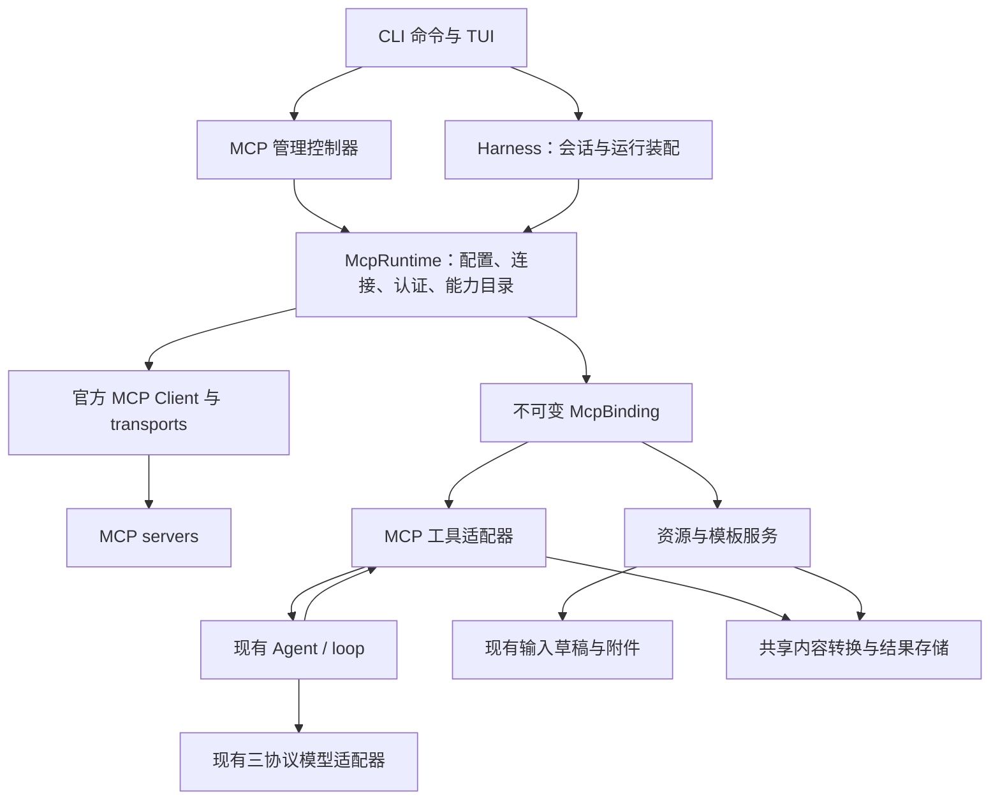

# CLI Agent 架构书

项目目标是逐步构建一个可开源、可持续使用和演进的产品级个人 CLI agent。开发过程同时服务于用户理解源码：从简单到复杂逐步补齐能力，并持续加入自己的设计和想法。学习决定每次推进的大小，产品目标决定框架和功能的设计。

**长期产品目标（2026-10-21 明确，尚未实现）：** agent 根据用户的一句话描述，动态修改自身 CLI 的功能，范围包括工具、CLI 界面等，并通过热启动应用变更。需求解析、变更实施、验证及热启动机制仍待设计和实现；现有 `/reload` 仅重载模型配置，不能据此视为已经具备该能力。对外说明和预计架构图见 [中文 README](../README.md) / [English README](../README.en.md)。

**MCP（2026-11-18）**。Harness 持有 `McpRuntime`，通过 `/mcp` 管理配置、信任、stdio／Streamable HTTP 连接、认证和目录。每次提交在校验模型凭据后取得一份 binding。工具来源从该 binding 生成模型可用的 `AgentTool`；loop 负责参数校验、审批、执行和结果回传。资源工具与服务器工具共享 binding。CLI 的 `/mcp-resource` 和 `/mcp-prompt` 独立取得所选服务器的绑定，把预览过的材料加入草稿。详见 [MCP 运行时与工具契约](#56-mcp) 和 [开发进度](./progress.md)。

**子代理与 steer（2026-11-22，beta 工作区）**。主代理可后台派发、等待、暂停和恢复子任务。活动请求接收补充消息，工具结果配齐后交给下一轮推理。[子代理与运行中输入](#57-子代理与运行中输入)

本文只保存**当前有效的设计、实际项目状态和已确定的后续目标**。开发历史、当前版本待办和验收记录见 [progress.md](./progress.md)。新对话先读进度，再根据本文了解设计；不需要从旧版决策中拼出当前规则。

**输入迁移状态：**输入迁移功能已完成，旧输入 `stash` 和旧同步 `utils/image.ts` 已删除。完整草稿、长文本/图片引用、撤销/重做、REPL 命令、Harness 提交和流式显示已接通，`npm start` 可交互对话。上下键仅移动当前输入光标，不提供历史召回。正式测试已迁入 `tests/`，使用 `node:test + tsx`、共享测试环境和三端 GitHub Actions，命令和验收边界见 [测试指南](#8-测试与-ci)。旧 `test/` 已退役并移出项目；原生终端、真实剪贴板和具体终端应用仍需对应环境验收。

**TUI 当前结构（2026-11-03）：** 界面统一位于 `src/tui/`，与 `harness/`、`agent/` 平行。整体 TUI、FB-001～029 反馈修复及历史回看闪烁修复已接入：`ReplScreen` 取代 `ReplView`，`terminal-repl.tsx` 负责启动、控制器、终端与焦点装配。消息／工具／Markdown／Diff 为分层 React Ink 组件，控制器投影结构化历史和活跃回合，Harness 提供数据与权限钩子。当前结构与交互统一见 §4，验证和最终 Review 待办见 [progress.md](./progress.md)；施工计划、试用及反馈专题文档已退役。


---

## 0. 产品方向与推进方式

### 0.1 框架先确定，实现分小步

- 当前优先补齐已经规划的核心能力，做出能完整运行的 agent。产品级是持续建设的目标；每个版本交付其中一部分，不以练手为由刻意降低实现质量。
- 对已确定的模块职责、数据流和近期功能，能一次搭好的框架就先搭好。接口、类型和函数入口可以先保留，后续沿同一套设计填充，减少因临时方案造成的反复重构。
- 预留入口标明未实现，不把占位当成可用功能。框架先行不等于提前实现全部功能，也不为尚未确定的需求铺设大量兼容分支和兜底。
- 每批必须新增或完善一个主流程函数，交付清楚的输入、处理步骤和输出；期间更新的功能函数、必要类型和接线不计数量，不再按函数总数拆批。每批改之前先说明主流程函数和配套改动，默认写完后 review；当前 TUI 按用户要求整体完成后先试用、集中反馈、满意后最终 Review。版本目标可以跨多批完成；例如上下文容量是一个版本目标，不要求一次写完窗口、计量、显示和压缩。
- 每个功能点尽量直接采用整个功能完成后仍会保留的结构和行为，避免为当前小批临时能跑而加入过渡类型、临时接线、假实现或短期分支，后续再大改。依赖紧密、难以独立完成时扩大本批范围，合并相关步骤，一次完成一个完整功能后再 review；不要为了拆小步制造后续需要推倒的实现。
- 文件中的已知职责应尽量一次按最终结构完成。若必须保留以后确定会替换的代码，动手前说明依赖，在代码原处注明阶段性原因、替换条件／批次，并在交付中列具体位置；仅在规划文档写待办不够。新增能力与替换已有逻辑分别说明，不为“以后可能共用”主动制造重构。
- 一个功能全部实现完再开始测试，验证方式和结果在功能完成后一起交代。实现过程中发现设计冲突、边界或影响面问题，当场说明，不留到 review 之后。允许修改已有函数、填充占位和调整必要的类型；减少返工是设计目标，不是「代码写过就不能再改」的禁令。

### 0.2 分层职责

`Harness` 承担装配、请求与会话管理，职责见 §4；Agent、loop 与工具执行细节见对应源码。

图片粘贴、会话命名等功能按用户可见的使用行为设计，讲解时说明设计理由和取舍。

实现时优先看当前小点涉及的函数和调用方；需要理解上下文时再扩展阅读。§5 的位置是阅读入口，不是禁止阅读其他文件的约束。

### 0.3 文档只保留有效状态

- 架构书回答“现在是什么、接下来做什么、为何这样设计”，不保留已经失效的方案和施工历史。状态或目标更新时直接改对应段落，避免不断追加互相覆盖的补充规则。
- 进度文档保存历史改动，以及当前版本已完成、已起步、未完成和待验收的事项。实现、设计决定和验证结果分别写清，不能把“决定要做”写成“已经做完”。
- 单项功能实施文档用于开发阶段。实现后，将有效设计与接口并入架构书，将交付记录、验收与待办并入进度页，再删除实施文档。读源码发现的问题与修复计划按编号写入[源码评审记录](./review-records.md)。
- 每完成一个小点，同步当前状态和进度；版本完成后，由用户确定下一阶段目标，再更新架构书。旧版本的过程留在进度文档和 Git 历史中。
- 本文的“本版不做”只限定当前交付范围，不是永久禁止。用户已确定的实现和版本目标保持有效；调整目标时同步更新当前设计，避免新旧规则并存。

**配置错误处理约定（必须遵守）：** Harness 的创建和会话生命周期必须独立于模型配置。没有配置、配置损坏或请求失败，都不能阻止 Harness 启动或让交互 CLI 退出；`/new`、`/resume`、查看上下文等不依赖模型的功能必须照常可用。模型缺失以 `undefined` 表达，不使用假模型或空 key 凑出启动条件。只有聊天、压缩等依赖模型的操作在内部检查模型／凭据，缺失时中止该操作，提示原因及修正入口；应在写入消息、保存图片等副作用前拦截。

配置加载／应用边界校验 JSON、schema、引用、地址和参数约束；以后增加保存入口时，须先校验候选，失败不写盘。校验失败保留上一次生效配置和会话，没有可用配置时仍保持 Harness 可用。凭据解析、协议支持与请求编码在需要模型时处理，不能扩大成启动门禁；HTTP／流内错误沿请求错误事件显示并回到输入状态。底层可用 `ByokConfigError` 中止无效操作，由配置边界或 REPL 转为诊断，不交给顶层退出分支。不得自动探测远端接口，不回显凭据或原始配置，不擅自回退模型。管道同样先识别操作：会话命令不因模型配置错误失败，依赖模型的操作失败才返回非零。必须验证“无配置仍能恢复会话、修正后在原会话继续、坏候选保留旧配置、请求失败后仍可操作”，不能只测是否抛错。参见 [No.5 修复记录](./review-records.md#no5--模型配置问题会导致-cli-直接退出)。

### 0.4 源码讲解方式

**适用前提：只有用户明确要求逐行解释某个函数时，才启用本节标准，并仅用于当次指定的函数。其他情况下忽略本节格式，按当前问题直接说明概念、逻辑或作用。**

启用后，用简短、准确的自然语言翻译代码实际发生的事情，帮助用户建立代码与功能的对应关系，围绕用户指定的函数讲解。

- 保留原代码，按执行顺序拆成小段；每条有实际含义的代码行单独展示，对应解释紧跟在该行下方，保持一一对应。闭合括号可以保留，无需逐个解释符号。
- 每行直接说它做了什么：定义函数时说明参数分别代表什么；定义变量时说明保存什么、初值是什么；判断时说明检查哪个变量的哪些条件、满足后发生什么；赋值时说明哪个状态变成什么；调用函数时说明传入什么、被调用函数会完成什么操作。
- 语法说明只保留理解当前动作所需的内容，例如“定义函数”“定义箭头函数”“准备一个数组”。无需把每行拆成“语法 / 功能”两套说明，也不逐个展开 `new`、运算符或标点；用户专门问语法时再展开。
- 每个逻辑段讲完后，用一小段话说明这部分完成了什么、在整个功能中起什么作用，把逐行动作连成流程。
- 参数、下标或计算容易混淆时，用短输入和具体数字演示：先算出实际传入的值，再说明它成为哪个参数，以及调用后哪些状态发生变化。涉及位置时说清它属于原文下标还是显示列。
- 边界说明围绕当前代码的实际条件和结果。发现设计冲突或代码问题时，仍按 §0.1 当场说明，并区分代码推导和实测；段末以用途说明收束，不追加与当前代码语义无关的假设风险提示。

例如，讲解处理换行的两句调用时，采用下面的排版：

```ts
finishLine();
```
保存换行符前面的当前行。

```ts
startLine(index + segment.length);
```
把换行符之后的原文下标传给 `startLine`，从这个位置初始化新行。

这一段先收好上一行，再准备下一行，让后续字素从新行继续加入。设计理由和取舍仍按 §0.2 说明。

---

## 1. 现在有什么 / 这一版做什么

| 能力 | 当前状态 |
|---|---|
| 对话与工具 | Harness、多轮对话、`read` / `write` / `edit` / `bash`、流式和 abort 已接入新 REPL；交互入口已恢复 |
| 装配与会话 | 工具和系统提示在 `src/harness/`；`Harness` 装配 Agent，按 cwd 保存 jsonl；新 REPL 已接回 `/new`、`/resume` 列表与序号选择 |
| 终端输入 | 输入迁移已完成；唯一 stdin 宿主、协议解析、焦点分发、多行字素编辑、粘贴合并、完整附件草稿、撤销/重做和提交展开已接通；非 TTY 在 EOF 提交一次原文 |
| 命令入口与 TUI | / 菜单、@ 文件补全、结构化消息与工具卡、Markdown／Diff、权限审批、主题／焦点与状态栏已接入；模型／思考／会话／配置／语言使用二级界面，显式参数继续兼容 |
| 图片输入 | `read` 与输入支持 jpeg/png/gif/webp；异步图片路径/剪贴板读取交给完整草稿，输入中显示可删除/撤销的引用，提交时发送真实图片内容 |
| 协议适配 | 上层使用 streamModel；已实现 Chat、Responses、Anthropic 的请求、思考、工具与图文转换。SSE 处理分块、usage、错误与取消，缺少结束原因时报错 |
| 上下文容量 | 窗口、用量、摘要、自动压缩及手动 `/compact` 已接回新 REPL，`/context` 与每轮 `ctx` 显示可用；本地 HTTP 摘要与续聊验证通过。窗口由 BYOK 模型配置提供，用量优先取接口 `usage`；真实模型压缩验收暂缓 |
| 思考等级与 BYOK | 三协议、统一设置、逐请求凭据、压缩、会话选择恢复和思考显示均已接通；九家厂商有限绑定与 36 个连接预设已完成，既有 review 尾项保留 |
| Skills | 用户／项目发现、统一 `skill` 工具、`/skill` 二级菜单、参数展开、权限和会话／压缩恢复已接入；本轮验证见 progress，尚未提交 |

**这一版（v1.2）的既定目标：**

1. 把工具和系统提示收进 `src/harness/`，`main` 不再 `createXxxTool` / `new Agent`。
2. `Harness`：开局装配；`prompt` 交给 Agent；每轮收尾。
3. 按 cwd 把对话写成 jsonl（一个项目多份聊天）。会话名从第一条用户消息截出来，不另跑模型起名；`/resume` 用「名字 + 上次打开时间」分辨。
4. **上下文容量**：窗口设置、用量记录、REPL 显示、自动压缩与溢出重试；手动 `/compact` 在用量超过窗口 1/4 时可用。
5. 思考等级与 BYOK 作为一项功能设计和实现：用户配置模型连接，使用固定五档与独立思考开关，适配器按模型／接口规则处理；支持 OpenAI Chat Completions、Anthropic Messages 和 OpenAI Responses 的基础对话与工具调用。

图片文件和剪贴板读取已通过新输入接入完整草稿；提交时按有效引用收集真实图片内容。

**后续范围：** 原计划 v1.3 的整体 TUI 已提前接入当前版本，后续完成用户复试及最终 Review，不再按施工计划重复实现。v1.2 的三协议、固定五档／独立开关和厂商适配已完成，后续按实际需要补模型绑定与真实接口验证。Windows Shell 问题（No.1）已修复并通过三端 CI，验证边界见问题记录。会话继续使用线性 JSONL，不做会话树、`/tree` 或树状 fork，也不引入 SQLite。v1.1 遗留手测继续在进度里记录，不阻塞 v1.2 开发。

---

## 2. v1.2 目标行为

下面的会话、命令和上下文行为已接入新 REPL；BYOK 已实现三协议与统一设置链，配置入口见 [厂商示例](../byok.providers.example.json)，验证范围见 [开发进度](./progress.md)。输入链路的当前职责见 §3，验证范围见 §7。

```text
main（屏幕）
  输入组件：多行草稿、/exit /new /resume /context /compact
  每轮后一行 ctx used/window
  Ctrl+C abort
        │
        ▼
Harness（管家）
  开局：建工具、prompt、new Agent、加载或新建 session
  每句：harness.prompt(text, images?) → agent.prompt(text, images?)
  消息落定：写 jsonl；收尾：更新用量，必要时压缩
        │
        ▼
Agent / loop（已有，不改职责）
        ├── tools（harness/tools）
        └── 协议适配器（Chat Completions / Anthropic Messages / OpenAI Responses）
```

新 REPL 从输入组件接收完整草稿、展开引用、处理斜杠命令、订阅事件并处理中断；不创建工具，不 `new Agent`。`main.ts` 先装配 Harness，再尝试加载配置，最后选择 TTY 交互或非 TTY EOF 提交。`ByokRuntime.reload()` 只负责候选配置的加载、校验与应用；通过 main 注入的回调调用现有 `Harness.configureModel()`，不持有或创建 Harness。无配置时 Agent 的 model 为 `undefined`，工具、消息和会话管理照常工作；具体模型操作内部检查配置。`/reload` 重试最近的路径与选择，`/config [路径]` 查看状态或更换文件，`/model <模型键>` 选择本次运行的模型；失败候选与当前生效配置分别保存，设置成功应用后才提交配置状态。重载不重建 Harness、Agent、会话或订阅。交互输出统一经 Ink，非 TTY 增量写回复；终端事件、编辑和提交各自分层。

**命令与界面：** `command-registry.ts` 统一定义 14 条命令，供识别、帮助和菜单使用。`PromptSuggestionsController` 提供 / 命令与 @ 文件补全。模型／effort／思考／思考展示／恢复会话／配置管理／语言无参数时进入 `CommandDialogController` 管理的二级界面，经同一 `InputDispatcher` 接管模态输入；确认调用真实 `ByokRuntime`／`Harness` 接口。`ConfigProfiles` 提供配置发现、表单映射、校验与原子保存，应用失败回滚文件。`ReplScreen` 在单一视窗中组合历史与活跃消息，输入框固定底部。具体职责与交互见 §4。

磁盘采用按项目分桶的线性会话，格式为：

```text
~/.anti-trace/profiles/local/projects/<cwd SHA-256>/sessions/<ISO时间戳>_<id>.jsonl
```

项目 ID：先将 cwd 转成规范化绝对路径，再计算 SHA-256；项目路径同时保存在 `project.json`。同一目录多个 jsonl = 多次聊天。启动默认**新会话**；`/new` 再开一份。第一条 assistant 出现才建文件。

**会话名：**

- 取第一条 user 消息的纯文本（空白收成单空格），截到最多 **10 个字符**；不够 10 个就全留下。空则 `untitled`。
- 当前命名不调用 LLM，不提供 `/name`，名字存入 header。
- 名字写进 header 的 `name`：内存里 `createSessionFile` 时还没有用户话；**第一次 flush**（首条 assistant 落盘）时已经有 user 消息，那时填上，之后不改。
- 上次打开时间用该 jsonl 的 **mtime**。`/resume` 加载时 `touch` 一下，即使没再说话也算打开过。

**`/resume`（交互选择器与管道文字入口）：**

- 列出当前 cwd 桶内已落盘的会话，按上次打开时间新到旧，每行：`序号. 名字  YYYY-MM-DD HH:mm`。
- TTY 中 `/resume` 打开会话选择器，↑↓ 选择，Enter 调用 `resumeAt`，Esc 取消；非 TTY 保留列表与序号输入。
- 只有整行恰好是 `/resume` 才进这条命令；`/resume 2` 这类不算。
- 没有可 resume 的文件则打印一句，不 throw。不自动打开最近一份。

jsonl 首行 header，之后每行一条，使用线性 append，不包含 `parentId` 树：

```json
{"type":"session","version":1,"id":"...","timestamp":"...","cwd":"...","name":"帮我改一下"}
{"type":"settings","modelRef":{"configPath":".../byok.json","modelKey":"main"},"thinking":{"effort":"high","enabled":true}}
{"type":"message","message":{...AgentMessage}}
{"type":"compaction","summary":"...","keptMessages":[...]}
```

**思考等级现状：** `agent.state.thinking` 保存 `{ enabled?, effort }`，档位固定为 `low / medium / high / xhigh / max`。初始档位 medium，开关未指定表示服务端默认；关闭仍保存档位。`createLoopConfig()` 复制模型（含 adapter 规则）与偏好，loop 传到统一 StreamFn；三协议已按规则完成真实编码与思考解析。Harness 提供 setThinkingLevel / setThinkingEnabled；CLI 提供 /thinking、/effort 和独立 /thinking-display。JSONL settings 保存模型目录引用与偏好；/new 继承，/resume 恢复，缺引用保留历史并提示当前模型。

**上下文容量**先有窗口和用量。压缩在用量过线，或这轮回复表明上下文装不下时自动发生。

1. **窗口：** 数字在 `Model.contextWindow`，由 BYOK JSON 中当前模型的 `contextWindow` 提供正整数，缺失或无效时报配置错误。`/context <正整数>` 只改本进程这份 `Model.contextWindow`。
2. **记录：** 优先用 AssistantMessage.usage；没有则用现有估算。Harness 记住 usedTokens，屏幕只显示 used/window。正常对话追加消息，压缩换成摘要＋原样尾部。Chat 的字符串思考已按 adapter 策略回传，默认 omit；文字、图片和工具调用继续按角色转换。
3. **显示：** 接口是 `contextUsage(): { used: number; window: number | undefined }`。没有模型时仍可查看用量，窗口显示“未配置”。REPL 每轮结束后显示 `ctx <used>/<window>`，`/context` 无参数读取同一份状态；修改窗口需要已有模型。
4. **压缩：** 自动路径已调用同一套切点和摘要。默认 `reserveTokens = 16384`，`keepRecentTokens = 20000`。磁盘 jsonl 保留全文；发给模型的是摘要 + 尾部。一轮里最多自动压一次。手动 `/compact` 仅在 `used > window / 4` 时尝试同一套压缩；没有可压旧历史或刚压完没有新消息时明确提示。
   - 一句 `prompt` 正常结束，且 `used > window - reserveTokens`：压缩，不重试。
   - `stopReason === "error"`，且 `errorMessage` 是上下文满了（“exceeds the context window” / “maximum context length” 这类句子）：丢掉这条报错的 assistant，压缩，再用当前 messages 重跑一轮。只试一次。再满就停，把错误留在屏幕上。
   - `stopReason === "stop"`，且这轮 `usage.input > window`：接口收下了超长输入。压缩，不重试，已经打出来的回复留下。
   - `stopReason === "length"`，且 `usage.output === 0`，并且 `usage.input >= window * 0.99`：输入被截满、没有正文。丢掉这条空 assistant，压缩，再用当前 messages 重跑一轮。只试一次。
   - 重试不再调用 `prompt(text)`，避免多塞一条 user。没有 `usage` 时，后两条不触发。

`/new` 清内存并换新 jsonl 句柄（旧文件留下）。`Agent.reset()` 只清消息，不换文件。

---

### Skills 的运行结构

`Harness` 持有 `SkillRuntime`，装配统一的 `skill` 工具；`loader` 发现并缓存 SKILL.md，`registry` 管理定义与诊断，`runtime` 处理参数和调用快照。项目技能目录固定为 `cwd/.anti-trace/skills/`，不向父目录扫描；用户目录为应用根目录下的 `skills/`（默认 `~/.anti-trace/skills/`），跨项目和 profile 共用；同名技能项目优先。Harness 用同一组实际目录装配注册表和系统提示词，创建默认项目级，用户指定个人／跨项目时写用户目录。提示词始终提供目录和基本格式，因此空技能集合也支持通过既有文件工具创建首个技能。没有可供模型调用的技能时不暴露 `skill` 工具和初始技能列表。

`/skill` 是固定一级命令，二级菜单从技能集合动态生成；`/skill <name> [args]` 支持显式和管道调用。用户选择和模型调用共用 `SkillRuntime.prepare()`。目录在模型请求前作为 `isMeta` 用户消息注入，只含名称与描述；工具激活后通过通用 `AgentToolResult.newMessages` 注入正文。loop 先完成整批工具结果，再追加上下文消息，三种协议沿用普通工具／文本编码。

程序生成的消息保留在 JSONL，但不进入用户气泡和会话命名。已调用技能按名称保留最近展开结果；恢复会话从原始消息重建，压缩通过 `CompactionEntry.skillMessages` 保存预算内正文（每个约 5000 tokens，总量最多 25000，且受当前窗口限制）。每次请求前检查目录，自动压缩后再补齐一次，确保首次续接即包含最新技能列表；补充消息同步落盘，已保留的目录不重复添加。错误超限恢复先识别刚压缩上下文，再补目录，避免重复压缩。工具预授权只在本轮有效，不从历史恢复。

权限支持普通工具名的 `allowed-tools`，模型调用带授权的技能需审批；手动选择明确使用其本轮授权。暂不支持的 Claude 扩展（fork、Hooks、路径条件、动态 Shell、专属模型／effort及命令匹配授权）产生加载诊断，不作为可用技能展示。没有模型配置时发现、菜单和重载照常工作。

## 3. 文件职责与待接通部分

| 文件 | 职责与状态 |
|---|---|
| `src/harness/harness.ts` | 装配、会话、设置、请求快照、用量与压缩；普通请求／摘要共享模型、偏好和逐请求凭据；取消不提交摘要 |
| `src/harness/session.ts` | cwd 分桶、jsonl 持久化、命名、列表和恢复；已有 compaction 行读写结构 |
| `src/harness/tools/*`、`src/harness/prompt.ts` | 工具实现与系统提示；图片识别和缩放辅助位于 `tools/image.ts` |
| `src/harness/context.ts` | 已有 `estimateTokens` / `estimateMessagesTokens`；后续承接摘要用量等上下文容量逻辑 |
| `src/harness/skills/*`、`tools/skill.ts` | 技能发现／解析／登记、共享展开、目录披露、调用快照与模型工具入口 |
| `src/harness/compaction.ts` | 阈值、溢出判断、切点、摘要与包装；本地 HTTP 摘要/持久化/续聊已验证，真实模型验收暂缓 |
| `src/cli/ink/terminal-host.ts`、`terminal-input.ts` | 第 1–2 批宿主与解析：真实 stdin 的唯一读取者，管理 raw mode 和 bracketed paste，并将字节解析为终端事件；Ink 只负责渲染 |
| `src/cli/input/keybindings.ts`、`input-dispatcher.ts` | 快捷键纯解析、默认编辑/撤销/图片映射、REPL 退出覆盖与焦点分发；已接入真实组件和运行入口 |
| `src/cli/input/text-input-state.ts`、`text-input-layout.ts` | 第 4 批完成：纯字素编辑及共享显示行列映射，供上下移动和基础组件渲染共用；保留原文 |
| `src/cli/input/text-input-controller.ts`、`use-text-input.ts`、`base-text-input.tsx`、`terminal-text-input.tsx` | 同步动作、Enter/换行、精确编辑范围、上层引用变换与 React 重画；基础适配器可独立运行，正式 REPL 复用控制器和组件 |
| `src/cli/input/paste-handler.ts`、`src/cli/utils/image-paste.ts` | 100 ms 粘贴合并、同步 pending、按序交付文本/图片、异步读取及停止/换草稿清理；图片交给完整草稿层 |
| `src/cli/input/prompt-draft.ts` | 文字、光标、可信引用范围与附件同属不可变草稿；`preparePromptSubmission()` 展开原文并收集图片 |
| `src/cli/input/prompt-input-controller.ts`、`prompt-input.tsx` | 长文本/图片占位、原子移动与删除、完整草稿撤销/重做、提交门槛与输入显示 |
| `src/cli/repl/repl-controller.ts`、`terminal-repl.tsx` | 命令／会话、busy 门槛、结构化 transcript／activeItems、管道文字投影、权限策略及唯一宿主装配 |
| `src/tui/*` | ReplScreen 根界面、主题／焦点／通用原语、消息与工具卡、Markdown／Diff、输入外框、补全和审批 |
| `src/config/byok.ts` | 加载用户空间 `configs/main.json` 或显式路径 JSON，校验连接与模型目录、选择启动模型并独立读取凭据；JSON 是唯一模型配置来源，缺失或损坏均报错；不加载 dotenv |
| `src/cli/main.ts` | `runCli()` 先创建 Harness，再尝试应用 BYOK 配置；TTY 交互和非 TTY EOF 提交共用 REPL 逻辑，配置错误不阻止会话命令；导入不启动进程 |
| `src/cli/byok-runtime.ts` | 保存待尝试选择、有效配置及诊断，加载校验后通过回调应用设置；提供模型键和可恢复结果，不管理 Harness 生命周期 |
| `src/llm/adapter.ts`、`rules.ts`、`sse.ts` | 统一入口、adapter schema／配置校验／规则与编码模板、可复用 SSE 分帧；当前接入 Chat |
| `src/types.ts`、`src/agent/agent.ts`、`src/agent/loop.ts` | BYOK 公共数据、模型／偏好（含 adapter）快照、请求选项与 hook 的显式覆盖；线上字段留在协议适配器 |
| `src/index.ts` | 导出 Agent、Harness、流式适配和工具等现有入口 |
| `tests/support/` | 共享测试 Harness、脚本化模型、本地 HTTP、临时目录和异步等待 |
| `tests/integration/`、`tests/regressions/` | Agent、会话、自动压缩、协议与工具验证，以及具体故障回归 |
| 旧 `test/` | 已退役并移出项目；正式测试使用受版本管理的 `tests/`，见 [测试指南](#8-测试与-ci) |

**v1.2 后续：** 新输入及 `/new`、`/resume`、`/context`、`/compact`、每轮 `ctx` 已接回。思考等级与 BYOK 按 build 文档分批实施；保留 Agent / Harness 的消息和事件边界。

---

## 4. 分层

```text
terminal-host → InputDispatcher + FocusStack → 草稿／菜单／审批控制器
  │ 提交草稿与命令
  ▼
ReplController → Harness → Agent / loop → LLM 适配器与工具
  ▲                 │
  └── 结构化事件 ────┘
  │ transcript / activeItems / display
  ▼
ThemeProvider → LocaleProvider → FocusStackProvider → ReplScreen
  ├── TranscriptViewport：当前可见终端行，前后各 8 行缓存预取
  │     └── TranscriptLayoutCache → RowIndex → RowRenderer（仅内存排版）
  ├── 固定底部输入、Spinner、命令二级界面、补全、审批、状态栏
  └── Markdown / HighlightedCode / MarkdownTable / StructuredDiff
```

CLI 负责装配，TUI 负责交互与展示；真实 stdin 和终端输出始终只有一个宿主。主 Ink 实例只生成一屏 ANSI 帧，`RowRenderer` 复用另一个仅写内存流的 Ink 根，将现有消息组件排版为可缓存的终端行；该根不读真实输入、不运行动画。`ScrollbackOutput` 接收按范围取行的数据源与当前视窗／页脚，保存屏幕尾部检查点，增量输出到主屏幕的原生滚动历史；不再逐帧拼接、拆分或保留完整历史字符串。缩放时保留未滚入历史的行，并拒绝尺寸、会话版本或阅读模式过时的帧。不启用备用屏幕、重放 Static 或重建终端宿主。滚轮／PgUp 回看与 Ctrl+O 展开按消息 ID／消息内行位置锚定，Ctrl+End 返回最新并补齐期间生成的内容。原生投影收起，阅读视图独立展开，终端滚动条仍可查看已打印快照。管道继续使用文字投影。

历史缓存与每帧绘制分开：`TranscriptLayoutCache` 保留消息／分段的高度元数据，终端行采用最多 8 MiB、2048 个条目的 LRU 缓存；宽度、展开、思考展示和语言最多保留四种排版变体，主题或会话内容替换时失效。`RowIndex` 用 Fenwick 高度索引定位可见范围与更新实测高度，滚动不扫描和测量全部消息；未访问区域沿用已知高度或估计值，访问时才排版并校正。Markdown 按顶层块缓存，代码每 64 个源行、思考每 64 个显示行分段，代码高亮保留整块词法上下文。主界面只挂载可见行，工具指示灯和底部 Spinner 的动画不触发历史排版。打开对话框保留缓存，关闭后复用；首次恢复会话写入原生历史仍需输出完整内容一次。

`useFrameSnapshot` 将 TUI 的连续 REPL 通知在 16ms 窗口内合并，控制器和非 TTY 订阅保持同步；宿主也在 React 重排前合并根刷新请求。视窗准备在 React 提交之外执行，之后只提交与该排版请求匹配的帧。返回测量结果时校验对应的滚动偏移，避免较早的一帧覆盖新的滚轮输入。

启动品牌使用 `WelcomeHeader → BrandMark → brand-art.ts`，固定 54×6 的完整阴影艺术字，青色立体闪电代表 I，方向为左上到右下；真彩下黄色／青色逐行明暗变化，闪电侧边单独变暗。画稿为整体绘制的阴影轮廓与逐行明暗层次，不在运行时按字母表拼接。60／120 列使用同一份画稿；极窄时实际字符在进入 Ink 前按列数裁剪，各行固定一格高，窗口恢复后显示完整画稿。256／16 色与无色终端沿主题降级，没有终端图片协议依赖。

### 4.1 TUI 组件与数据边界

| 模块 | 当前职责 |
|---|---|
| `src/cli/repl/` | `ReplController` 将 Harness 事件投影为 `transcript`／`activeItems`／显示状态，保留非 TTY 的 `entries`／`liveText`；`terminal-repl.tsx` 装配生命周期与终端 |
| `src/tui/layout/`、`messages/` | 根界面、启动头部、输入外框、状态／告警、叶子动画；结构化用户／正文／思考／通知／压缩边界与工具历史，不把 JSX 或展开状态写入模型消息 |
| `src/tui/markdown/`、`diff/`、`tools/` | Markdown、代码高亮、窄屏表格、行号与词级 Diff；Read 分组、Edit／Write 预览、Bash 实时尾部／退出码／耗时。展示元数据放在工具 `details`，原 `content` 继续供模型读取 |
| `src/tui/theme/`、`design-system/` | 主题 Provider、24／256／16 色及无色降级、符号；Divider／Pane／Dialog／Tabs／Select／MultiSelect／FuzzyPicker 等通用原语 |
| `src/tui/focus/`、`suggestions/` | `FocusStack` 按 modal → suggestion → editor → global 分发，模态期间保留全局中断；组件不自行读取 stdin。异步文件索引排除生成目录且不跟随符号链接 |
| `src/tui/commands/`、`src/config/config-profiles.ts` | picker／form／field 三类状态；配置发现、同文件新增模型、字段映射、校验、原子保存及应用失败回滚，真实设置交给 ByokRuntime／Harness |
| `src/cli/permissions/` | 工具执行前审批控制、权限模式、会话授权、键盘与反馈输入、Diff 预览准备及取消清理，通过 Harness 的工具调用钩子接入 |
| `src/tui/permissions/`、`locale/` | 审批弹窗渲染；`UiLocale`／`LocaleProvider` 响应语言切换，文案集中在 `src/cli/locale.ts` |

历史回看修复（No.2）：消息前的 Logo／空隙使用可为负数的消息内行位置，避免被钳到首条消息而反复跳动。宿主只提交同一 tick 的最新帧，使用同步更新序列包围单次输出，先覆盖行再清除尾部，减少可见空白和闪烁。

### 4.2 交互、配置与权限

- 启动从 `src/storage/app-paths.ts` 统一取得路径。配置选择顺序为显式路径／`CLI_AGENT_CONFIG`、项目上次选择、用户默认选择、用户配置目录中唯一有效的文件；多个配置无选择记录时通过 `/config` 选择。保存选择失败只提示、不阻止本次使用；无配置也能操作界面和恢复新目录中的会话。旧目录不再自动读取，旧会话不迁移。Enter 提交，Shift／Alt+Enter 换行；菜单中 ↑↓ 选择、Enter 确认、Tab 只补全、Esc 返回；`@` 补入文件后继续编辑，支持撤销及带空格路径。
- `/model`、`/effort`、`/thinking`、`/thinking-display`、`/resume`、`/config`、`/language` 使用二级界面；显式参数继续兼容。模型思考开关与思考正文展示分别控制请求和显示。
- `/config` 的已有配置、添加、修改位于同一菜单；修改进入模型列表，可在同一文件新增模型。字段列表 Enter 进入独立编辑页，确认只改草稿，Esc 放弃该字段；最终保存项或 Ctrl+S 才校验、写盘和应用。共享连接独立复制，API Key 遮挡且留空保留，不进入消息或会话。
- 配置发现范围为当前用户空间的 `configs/` 和显式选择的文件。新增配置默认写入 `~/.anti-trace/profiles/local/configs/`；语言偏好保存在 `~/.anti-trace/preferences.json`，即时更新当前界面。配置、默认模型、项目选择、会话和工具输出按 profile 隔离，默认 profile 为 `local`；`ANTI_TRACE_HOME` 可覆盖数据根目录。用户文字、模型内容与工具原始输出保留原文。
- 默认 `default` 模式直接读取，编辑与 Shell 先审批；`auto-edit` 自动允许编辑，Shell 仍审批；`yolo` 直接执行工具。启动可传 `--auto-edit`／`--yolo`，Shift+Tab 循环切换。审批支持本次允许、会话记住与拒绝建议；新会话清理会话授权。非 TTY 无法审批时直接拒绝，不等待输入。
- 权限通过 `Harness.setBeforeToolCall()` 接入既有 Agent 钩子，保留原调用方的前置检查并支持卸载恢复。中断审批或生成时，为同批剩余工具补齐取消结果，不继续请求下一轮模型；最终 Review 仍须核对实际执行链路。
- 滚轮／PgUp／PgDn 回看；Ctrl+O 在回看处原位展开／收起，在最新处定位最近工具；Ctrl+End 返回最新并收起。回看时新输出保持阅读位置，返回后补齐历史；Shift+拖动使用终端原生选字。

---

## 5. 模块说明书

### 5.0 工具与图片输入

工具位于 `src/harness/tools/`，系统提示位于 `src/harness/prompt.ts`，由 `Harness` 装配。`createXxxTool` / `buildSystemPrompt` 是现有入口。

新输入异步读取图片文件/剪贴板，经回调把真实图片内容交给 `PromptInputController`，草稿显示 `[Image #N]`。提交时只收集仍被引用的图片，沿 `Harness.prompt(text, images?)` → `Agent.prompt(text, images?)` 传递；`read` 的图片放在对应的 `ToolResultMessage.content` 中。图片不进入文本粘贴 `chunks`。OpenAI 格式由 `openai-chat.ts` 转换；协议附加消息只在构造请求时生成，不作为真实用户输入写回会话，工具来源和图文顺序保留。

---

### 5.1 `src/harness/harness.ts`

**做什么：** `Harness` 类。开局装配；之后 `main` 只跟它说话。

```ts
export interface HarnessModelSettings {
  model: Model;
  modelRef?: ModelReference;
  thinking?: ThinkingPreferences; // 初始偏好，三协议各自编码
  apiKey?: string;
  getApiKey?: (model: Model) => string | undefined | Promise<string | undefined>;
}

export interface HarnessOptions extends Partial<HarnessModelSettings>, StorageOptions {
  paths?: AppPaths;
  cwd: string;
  streamFn: StreamFn;
  sessionsRoot?: string; // 可选的自定义会话根目录，内部仍按 cwd SHA-256 分桶
  resolveModel?: (reference: ModelReference) => HarnessModelSettings;
}

export class Harness {
  constructor(options: HarnessOptions);
  readonly agent: Agent; // SIGINT / render 需要 isStreaming、abort、subscribe
  prompt(text: string, images?: ImageContent[]): Promise<void>;
  abort(): void;
  subscribe(listener: ...): () => void;
  newSession(): void;
  listSessions(): { filePath: string; name: string; lastOpenedAt: number }[]; // 按 lastOpenedAt 新到旧
  resumeAt(index: number): boolean; // 1-based，对应 listSessions 的序号；越界或没有则 false
  configureModel(settings: HarnessModelSettings): void;
  setThinkingLevel(level: ThinkingLevel): void;
  setThinkingEnabled(enabled: boolean | undefined): void;
  readonly settings: SessionSettings;
  readonly settingsWarning: string | undefined;
  describeSettings(): string;
  setContextWindow(tokens: number): void;
  contextUsage(): { used: number; window: number | undefined };
  manualCompact(): Promise<"compacted" | "below-threshold" | "nothing-to-compact">;
  compact(customInstructions?: string): Promise<boolean>; // 已实现；false 表示没有可压的旧历史
}
```

**现有框架：** 构造时先通过 `detectShellEnvironment()` 探测平台与 shell，再创建工具、系统提示和 Agent，允许模型未配置。macOS／Linux 保持 read/bash/edit/write；Windows 优先 PowerShell，检测到 Git Bash 时额外提供 bash。系统提示按 POSIX／Windows 分别生成，Windows 语法说明与实际 PowerShell 版本一致。shell 共用执行器、120 秒默认超时和有界输出排空，CMD 不参与 Bash 命令解释。`configureModel()` 在空闲时更新模型、偏好与凭据来源，保留消息、会话及订阅。`prompt()` 先检查模型并解析凭据，再调用 Agent；通过 `beforeModelRequest` 在首次请求和每次工具续接前检查压缩。`subscribe` 同时订阅 Agent 原始事件及 Harness 的压缩、最终结果事件；`prompt_end` 每次接受的 prompt 调用只发一次，确认全部恢复后的成败。`prompt()` 保持 `Promise<void>`；异常仍向调用方抛出，同时通过最终事件提供结果，REPL 避免重复报告。`abort` 取消本次 prompt、Agent 和摘要。`newSession` 调 `agent.reset()` 再换会话句柄，`resumeAt` 加载消息并重算用量，两者均不依赖模型。`manualCompact()` 保留空闲、用量门槛和压后无新消息的检查。思考 setters 校验并记录设置；请求前回调使用当次模型、思考和凭据快照，工具续接／摘要重试重新取 Key。

**范围：** Harness 是装配、请求与收尾的入口。extensions、队列和树导航不在当前版本范围。

---

### 5.2 `src/harness/session.ts`

**做什么：** 按统一项目路径定位会话、建文件、append、读回 AgentMessage；会话名和列表也在这里。消息中的 thinking／replay 随 JSONL 保存，settings 行只保存模型目录引用和偏好。loadSession 分别返回消息和最后设置，不从会话加载旧 URL／Key。

- `sessionDirForCwd(cwd, storage?: string | AppPaths): string` → 默认 `~/.anti-trace/profiles/local/projects/<cwd SHA-256>/sessions/`；传入字符串根目录时使用 `<根目录>/<cwd SHA-256>/`
- `sessionTitleFromUserText(text): string` → 前 10 个字符，见 §2
- `createSessionFile(...)` 只准备路径和 header（此时 `name` 可空），第一条 assistant 才 `writeFile` header + 已攒的行；flush 前用第一条 user 文本填 `header.name`
- `appendEntry(entry)`
- `loadSession(path): { messages, name }`
- `listSessions(cwd, storage?: string | AppPaths): { filePath, name, lastOpenedAt }[]` 按 mtime 新到旧；`name` 优先 header，缺则从第一条 user 消息现算
- `findMostRecentSession(cwd): string | undefined` 即列表第 1 条的 path
- `touchSession(path)`：更新 mtime（resume 时调用）

当前格式包含 settings 行，不包含树、lane 或 session_info。compaction / 用量相关行的读写也走这里，类型放在 `session.ts`。普通 CLI 传入统一的 `AppPaths`；`HarnessOptions.sessionsRoot?: string` 仅用于嵌入场景或测试中的自定义根目录。

**设计：** 会话目录按统一项目路径分桶，会话文件延迟到第一次写入才落盘，避免只打开不用的空文件。

---

### 5.3 上下文容量（`context.ts` + `compaction.ts`）

压缩的前提是：**知道窗口有多大**，以及 **当前用了多少**。这个功能包含窗口、计量、显示和自动压缩，分多个可 review 的小点接通。

**窗口**

- `Model.contextWindow: number`（必填于运行时）。由 BYOK JSON 的当前模型配置提供，配置缺失或无效时报错。
- `/context <n>` 改 `harness.setContextWindow`，写的仍是当前这份 `Model.contextWindow`。模型能力信息来源随思考等级与 BYOK 一起确定。

**记录**

- `AssistantMessage` 增加可选 `usage?: { input: number; output: number; totalTokens?: number }`。
- `openai-chat.ts`：默认请求带 `stream_options: { include_usage: true }`，可由 adapter.includeUsage 关闭。usage 在 choice 之前解析，可出现在独立尾块或 finish_reason 同块；字段映射 prompt_tokens→input、completion_tokens→output，input 不扣缓存。未返回 usage 时不写此字段。
- 每次主模型请求前，优先使用同一模型、系统提示和工具配置下最新 assistant 的 `input + output`，再加之后新增的用户消息、工具结果等估算。无可用 usage 时估算整段消息、系统提示和工具定义；文字按字符/4，图片按固定开销估。
- 主模型消息完成和下一次请求前都会更新 `usedTokens`。压缩后废弃被保留旧消息中的 usage 基准，重新估算，避免旧用量立即再次触发压缩。session 不必单开 usage 行；压缩记录可带 `tokensBefore`。

**显示（CLI，不是网页）**

- 对外只有 `used` 和 `window`。`contextUsage()` 返回这一对。REPL 例如打 `ctx 12345/256000`，`/context` 无参数打印同一对。启动、`/context <n>` 之后和每轮结束都用同一种形状 `ctx <used>/<window>`，不另打只含窗口的格式。
- 不在屏幕上拆 input、output、cache，也不打距离压缩阈值还剩多少。
- `compaction_start` 立即切换 TUI 的压缩进度，`compaction_end` 立即显示摘要入口和压缩前后用量，并恢复请求中的状态；无需等待本轮回复结束。管道也收到压缩完成提示。
- `agent_end` 只表示一次 Agent 执行结束。REPL 用 `prompt_end.result` 确认整次任务成功、失败或中断，再更新错误状态；恢复成功不显示中间超限错误，管道成功返回 0、最终失败返回 1。已通过事件报告的异常不会由外层 catch 重复打印。

**发给模型的前缀（缓存）**

- 正常对话每轮在末尾追加本轮的 user / assistant / toolResult。已经发过的系统提示、工具列表和更早的消息保持字节不变，以便复用服务端的前缀缓存。
- 流式生成只替换当前这一条还没写完的 assistant。不回头改旧消息的正文，不往系统提示或旧消息里写时间、用量。
- 思考块与完成后附加的 replay 留在本地记录里；Chat 按 omit／same-source／required 策略在请求副本中处理历史思考，不改原 session。文字、图片和工具按角色转换，保持相同历史转换的一致性。
- 压缩成功后消息变成「摘要一条 + 本次用户任务（若已不在尾部）+ 完整保留尾部」。本次任务只保留一次，工具配对、思考及 replay 原样保留。这次前缀会变一次，之后再次保持只追加，直到下一次压缩。

**压缩**

- `shouldCompact(used, window, settings)`：`used > window - reserveTokens`。每次主对话请求发送前检查，包含首次请求和工具批次完成后的续接；摘要请求不递归进入此检查。正常回复结束后不再额外执行阈值压缩。
- `stopReason === "error"` 且 `errorMessage` 表示上下文满了：丢掉这条报错的 assistant，压缩，再用当前 messages 重跑一轮。只试一次。
- 成功回复保留；新增内容在下一次请求前计入预算并检查。
- `stopReason === "length"` 且 `usage.output === 0` 且 `usage.input >= window * 0.99`：丢掉这条空 assistant，压缩，重跑一轮。只试一次。
- 默认 `enabled: true`，`reserveTokens: 16384`，`keepRecentTokens: 20000`。
- 合法切点包括 user 之前，以及一个完整 assistant 工具调用组之前；按调用 ID 确认全部工具结果配齐，未完成或不合法的组不切。保留尾部的目标为 `min(20000, floor((window - reserveTokens) / 2))`，并将当前用户任务原文保留一次。单组过大或尾部使压缩无法缩小时，将完整组一起纳入摘要。
- 摘要走现有 `streamFn`，原样发送完整上下文和 tools，在末尾加摘要指令以复用前缀缓存；模型若返回工具调用，忽略并重试一次，不执行工具。使用当次模型、思考偏好和动态凭据；输出上限为 `min(floor(0.8 * reserveTokens), model.maxOutputTokens, model.contextWindow)`。已有旧摘要时一并传入，包装说明最近原文和原日志路径，并要求自动路径继续当前任务。
- 摘要调用失败、取消或无法减少消息用量时不提交替换。成功才写回摘要和保留内容，追加 `compaction`，同时更新 Agent 状态与 loop 实际发送的消息。原始历史仍在 JSONL 中。
- 超限恢复产生的压缩记录带可选 `replacesError: true`；恢复会话时界面隐藏其紧邻的中间失败，原始错误仍保存在日志中。手动压缩及旧记录不隐藏此前真正失败的消息。
- 手动与自动路径复用内部压缩过程。手动入口保留 Agent/prompt 忙碌保护，内部路径只在请求前安全点运行。REPL `/compact` 仍检查 `used > window / 4`；取消后的摘要不会延迟写回，无法压缩或重试仍失败时报告最终错误。

手动 `/compact` 只在用量过 1/4 时运行现有摘要；无旧历史或刚压完没有新消息时提示。成功追加 compaction，内存换成摘要＋保留尾部；失败不换历史。分支摘要、文件列表元数据和宽 length 恢复不在本版。三协议思考链已接通，摘要传入当前思考偏好，逐请求动态凭据与预算重新校验均已接通；摘要只收普通正文。

**判定：** 溢出识别分三种情形——错误文本命中上下文超限、`stop` 且 input 超窗、`length` 且输出为 0；对应 `shouldCompact` 与 `isContextOverflow`。当前不做可恢复 length 分支；显示和窗口配置见上文。

---

### 5.4 思考等级与 BYOK（约定功能已实现）

统一设置链、选定厂商和本地验收已完成，既有 review 尾项保留。配置入口见 [厂商示例](../byok.providers.example.json)，模型绑定在 `src/llm/rules.ts`，命令见 README，验证记录见 [开发进度](./progress.md)。两份 BYOK 专题文档已按用户要求退役。

配置使用用户空间 configs/main.json 或明确指定的路径；loadByokConfig 校验连接／模型目录并分离凭据。连接与模型可填 adapter：模型按字段覆盖连接默认，其中 thinking 整条替换。运行时模型不含凭据，adapter 随 createLoopConfig 的 structuredClone 一起快照；现有 loop 与内部 hook 行为继续复用。

runCli 使用统一 streamModel，三协议均已接通。Chat 的 prepareChatRequest 选择规则，映射思考，序列化历史与工具，校验输出上限；fetch 只负责 HTTP；readSSE 解析正文、思考、工具与 usage，输出已有事件，不新增工具循环。rules.ts 集中保存 schema、规则选择与 effort／toggle／budget 模板，sse.ts 负责与 HTTP chunk 无关的分帧。

用户固定五档和独立开关：未指定开关不发思考控制，开启按原生顺序映射或直接查五档预算；关闭保留档位，必须有真实关闭编码。合并输出限额的预算规则为回答预留空间，装不下最低预算则失败。未知接口不猜 effort；用户明确配置优先于明确启用的预设／模型绑定，再使用协议默认。OpenAI 绑定 GPT-5.1/5.2，其他厂商按 rules.ts 中的有限型号绑定，不自动套用未来型号。

Chat 可按配置解析 reasoning_content 或 reasoning 字符串，保留与正文交错的顺序。验证整条流完整结束后才给思考片段附 replay；source 含协议、连接、模型和规范化实际推理 URL。历史按 omit／same-source／required 策略处理，只发送完整同源数据；旧显示文字不当成原生数据，原 session 不变。截断／错误／取消不附 replay，未完成工具调用不作为合法调用落盘。Responses 使用无服务端会话依赖的 store:false／input items，按厂商规则处理加密 reasoning、明文 content 数组／对象或 summary；只有加密模式发送 encrypted_content include。Anthropic 默认回传完整 thinking 签名与 redacted-thinking，兼容规则可允许无签名、选择 Bearer 及独立预算；Claude 默认预算工具续接仍校验必要数据。字符串工具结果的图文附件在整批工具结果之后分组发送。Chat 已接通 MiniMax reasoning_details 与 Gemini thought_signature；36 个连接预设在 config/presets.ts 中维护，模型范围由 rules.ts 的有限绑定确定。

配置错误恢复、模型／思考设置、逐请求凭据、压缩设置、JSONL 恢复和显示已全部接通。新增源码为 config/presets.ts，公共可选 replay 扩展到 ToolCall 和 AssistantMessage 以承载 Google 签名。protocol-utils.ts 共用传输、取消、能力检查与事件函数；协议各自校验消息和结束条件。原生结束原因另存 rawStopReason；Anthropic usage.input 合计普通输入与缓存写入／读取。真实配置未修改，实际 DeepSeek 覆盖与网络失败见开发进度的 2026-10-20 记录。

---

### 5.5 `main.ts` 装配

启动：runCli 先创建 Harness，ByokRuntime 随后加载目录并回调应用模型、偏好与凭据解析函数，使用统一 streamModel；三协议均通过同一请求入口运行，缺参数或 HTTP 错误在操作内部报告。TTY 进入 startTerminalRepl；非 TTY 收集 UTF-8 输入到 EOF，再交给同一个 ReplController。

`npm start` 已恢复交互：输入完整草稿展开后调用 Harness，命令包括 `/new`、`/resume`、`/context`、`/compact`、`/help` 和 `/exit`。接受提交后清理整份草稿；在 beta 工作区，活动 Agent 接受忙时补充，等本轮工具结果配齐后再送给模型。Agent 事件由 REPL 投影到 Ink，不同时订阅直接写 stdout 的 `renderEvent`。退出、EOF、信号、回调异常统一清理订阅和终端模式；非 TTY 只打印模型/命令输出，退出码反映错误或信号。

---

### 5.6 MCP

Anti-trace 作为 MCP Host，通过客户端连接本机 stdio server 或 Streamable HTTP server，将 server 提供的 Tools、Resources、Prompts 接入现有会话。业务操作由 server 执行，Agent 负责选择、校验、授权、调用和结果回传。

运行期按服务器管理连接、身份和目录。一次用户提交在模型凭据确认后取得 binding，所有工具续接及溢出恢复共用这份快照。服务器管理、模型工具和资源／模板三条入口共享协议层和内容转换。

Skill 提供任务说明与工作流程，MCP 客户端负责发现和调用服务器能力。0.1.7 的实现范围为客户端 stdio／Streamable HTTP、Tools、Resources 和 Prompts。对外提供 MCP server、mcpo／OpenAPI 转换、旧 HTTP+SSE 或自定义 WebSocket、插件市场、工具搜索与延迟加载、sampling、elicitation、任务扩展、MCP Apps、资源内容持续订阅和配置自动监听均在该版本范围之外。



1. `src/mcp/` 处理 MCP 协议、运行期状态、目录和内容。SDK 类型停留在这一层，不进入 Agent、LLM adapter、React 状态和 JSONL。
2. Harness 创建并持有一个 `McpRuntime`；CLI 获得管理接口，但不另建连接。Runtime 不持有模型、聊天消息、终端或 React 组件。
3. Agent / loop 保持通用工具执行职责。MCP 工具与 `read`、`bash` 等使用同一条校验、审批、事件和结果配对链。
4. 模型适配器负责已有协议编码。MCP 不要求更换模型协议、不新增模型厂商专用的 MCP 调用通道。
5. Runtime 存活于 Harness 生命周期；`/new` 和 `/resume` 保留连接，清空会话级授权。恢复历史不执行历史工具，不从历史重新启动 server。
6. CLI 创建的 Harness 由 `runCli()` 在最外层 `finally` 中等待关闭；嵌入者传入的 Harness 由嵌入者管理，避免关闭不属于 CLI 的资源。

#### MCP 模块与绑定接口

| 模块 | 职责  |
|---|--- |
| `src/config/mcp.ts` | 读取、校验、合并配置，来源与覆盖信息，原子保存  |
| `src/mcp/types.ts` | 无 SDK 依赖的配置、状态、目录、调用、内容契约  |
| `src/mcp/runtime.ts` | server 集合、配置应用、管理接口、binding 与生命周期  |
| `src/mcp/connection.ts` | 单 server 连接、版本选择、请求、接收大小限制、超时、取消、关闭  |
| `src/mcp/http.ts`、`stdio-launch.ts`、`stdio-host.mjs`、`util.ts` | HTTP 有界接收、stdio 进程所有权、共享任务及运行限制  |
| `src/mcp/catalog.ts` | Tools／Resources／Templates／Prompts 元数据、分页、修订与失效  |
| `src/mcp/auth.ts`、`local-state.ts` | HTTP 认证、凭据、项目信任和本机启停覆盖  |
| `src/cli/commands/mcp-command.ts` | `/mcp` 参数命令与服务器管理菜单  |
| `src/mcp/tool-source.ts`、`tool-names.ts` | 工具来源适配、稳定名称、模型可见定义与调用绑定  |
| `src/mcp/content.ts`、`output-store.ts` | MCP 内容归一化、截断、图片／文件保存与来源信息  |
| `src/tui/tools/McpToolView.tsx` | MCP 工具进度、结果、来源和附件显示  |
| `src/mcp/resource-source.ts` | 资源目录／读取工具与用户资源读取入口  |
| `src/mcp/prompt-service.ts` | 获取模板、参数检查、转为可编辑草稿材料  |
| `src/cli/commands/mcp-context-command.ts` | `/mcp-resource`、`/mcp-prompt` 与草稿插入  |

| 契约 | 输入／输出及约束 |
|---|---|
| `McpRuntime.getSnapshot()` / `subscribe()` | 只读的脱敏 server 状态、配置来源、能力、目录状态及诊断 |
| `reload()` / `save(scope, id, value, expectedDigest)` | 校验配置后发布有效配置；保存检测外部修改并原子写入，错误候选不替换旧配置 |
| `connectServerAndDiscover(serverId, signal)` | 一个 server → 连接结果和工具目录；其余目录按管理请求加载 |
| `reconnect / setEnabled / trust / login / logout` | 显式服务器管理操作；配置变更与调用不能相互偷换身份 |
| `acquireBinding(signal)` | 等待本轮启用且受信任的 server 的有界连接尝试 → 目录与连接绑定；单 server 失败不让全部失败 |
| `McpBinding` | 保存 `serverId → ServerBinding` 的只读映射；每个 ServerBinding 固定连接 generation、配置／授权身份、能力和工具目录 revision；整个 binding 提供 `release()` |
| binding 的协议操作 | 显式指定 server 的 `listTools`、`callTool`、`listResources`、`listResourceTemplates`、`readResource`、`listPrompts`、`getPrompt`；返回项目定义的 DTO，接收 `signal`、超时和进度回调 |
| `McpRuntime.close()` | 幂等关闭，取消等待／认证／请求，释放订阅和进程，等待清理完成 |

不支持的 server capability 返回明确的“不支持该操作”，不以空目录伪装成功。正常的空目录与失败分开表示。绑定失效、认证缺失、取消、超时、协议错误分别保留错误类别，展示文字不夹带凭据。

Tools 在 binding 创建时固定目录；按需读取的 Resources／Templates／Prompts 在本 binding 首次使用该目录时取得完整快照，随后固定该目录 revision。只有被消费的目录参与对应操作的失效判断。所有操作始终绑定同一 server 身份和连接 generation；新增一个目录快照不能换掉连接。调用结束或取得工具来源中途失败时，所有已取得的 binding／source 必须在 `finally` 释放。

`ToolSource.acquire(runContext, signal)` 提供本次运行的工具、注明来源的提示和 `release()`。`runContext` 携带共用的 binding、模型能力和输出目录。审批收到 `provider / scopeKey / actionKey / label`，分别识别来源和实际操作。可序列化的 `kind: "mcp"` 结果详情供实时工具卡和恢复后的历史共用。

#### 配置、信任与服务器管理

配置路径由 `getAppPaths()` 按 `ANTI_TRACE_HOME`／`appHome` 和 `profileId` 解析。默认使用以下位置。

- 用户配置：`~/.anti-trace/profiles/local/mcp.json`。
- 项目配置：当前工作目录 `.anti-trace/mcp.json`，可共享。
- 用户私有状态：`~/.anti-trace/profiles/local/mcp/`，保存项目信任、本机启停覆盖和凭据；不写入项目 JSONL。

同名 server 采用项目整条配置覆盖用户配置，不拼接 command、args、headers 或 auth。管理界面显示生效来源与被覆盖来源。项目配置按当前工作目录读取，不向父目录递归搜索；相对路径相对于配置文件目录解析。

文档格式为 `{ "version": 1, "mcpServers": { ... } }`；导入时接受省略 `version` 的常见 `mcpServers` 容器，保存时规范化。stdio 可省略 `type`，HTTP 必须明确 `type: "http"`。未知字段报可定位的配置诊断，不默默丢弃。

| 字段组 | 固定语义 |
|---|---|
| 公共 | `enabled`（默认 true）、`startupTimeoutMs`（默认 10000）、`requestTimeoutMs`（默认 60000）；版本策略不作为用户配置字段 |
| stdio | `command`、`args`、`cwd`、`env`、`envVars`；env 保存非敏感固定值，凭据经 envVars 引用本机环境；按可执行文件和参数数组启动，不拼接 shell 命令 |
| HTTP | `url`、`headers`、`envHeaders`、`auth`；headers 保存非敏感固定值，凭据引用环境变量，Authorization 来源只能有一个 |
| auth | 无认证、`bearer`＋环境变量名、`oauth`＋可选 client ID／secret 环境变量、scopes／回调端口；三种互斥 |
| 工具筛选与输出 | `enabledTools`（可选白名单）、`disabledTools`（最后生效），按 server 原始工具名匹配；`outputMaxBytes`（默认 32768）限制每次工具／资源／模板交给模型的文本总量 |

配置文件缺失视为空配置；JSON／字段错误保留上次生效快照。合法配置中的连接失败只影响该 server。文件编辑成功但无法联网时保留新配置并展示连接错误，不把网络可达性作为保存条件。

用户主动设置的用户配置作为本机信任来源；项目配置必须显式信任后才启动命令、发送连接请求或进行 OAuth 发现。信任绑定规范化项目位置、配置来源及影响执行／访问目标的配置指纹。修改 command、args、cwd、URL、header／env 配置或认证方式需要重新信任；单纯调整超时不撤销信任。

用户在 TTY 中显式信任项目配置。服务器信任、OAuth 登录和逐项工具审批分别管理。`--yolo` 仍要遵守服务器信任、认证和工具筛选。

`/mcp` 在 TTY 中打开服务器管理菜单，在管道中等价于 `list`；显式参数包括：`list`、`status [server]`／`show <server>`、`tools/resources/templates/prompts <server>`、`add`、`edit/delete <server>`、`connect <server>`、`reconnect <server>`、`enable/disable <server>`、`trust <server>`、`login/logout <server>`、`reload`。纯管道不启动交互式 OAuth 登录；`login` 在该模式下说明需要交互入口，项目配置的显式信任和新增／编辑／删除表单也需要 TTY；查看、连接、重载和启停可用于管道。

菜单支持配置新增／编辑／删除、来源查看、能力目录浏览、信任、登录与连接操作；新增时选择“当前项目”（默认）或“所有项目”，分别保存到项目和用户配置。编辑写回原来源，删除项目覆盖项时明确提示用户同名项会重新生效；普通编辑通过字段表单，数组／映射字段用 JSON 值编辑并在保存前校验。启停覆盖写入用户私有状态，不擅改项目共享文件。凭据字段显示引用或掩码。

#### 传输、认证与目录生命周期

stdio 和 Streamable HTTP 共用官方客户端 `@modelcontextprotocol/client@2.4.0`。SDK 以 `versionNegotiation: { mode: "auto" }` 探测版本。探测和正式连接共用启动期限，按协议响应和 stdio 探测超时规则回退。界面显示协商版本。HTTP 探测超时、网络错误和认证失败保留各自诊断。

stdio 使用最小系统环境和显式转发变量，保留各平台运行可执行文件所需的 PATH／HOME／Windows 系统变量；不整包继承模型 API key。stderr 单独收集并有界显示，不能写入 Ink stdout。Windows 命令解析与进程树退出在这一块处理完整，不借 `bash.execute()` 代管 MCP。

stdio 的每次 SDK 探针及正式连接分别持有进程所有者：POSIX 使用独立进程组；Windows 由系统 Windows PowerShell 启动器先将自身加入 kill-on-close Job Object，再启动 Node host 及服务器，避免 SDK 立即终止探针启动器时留下后代。启动器只执行静态脚本，配置参数通过环境中的 JSON 传入 Node，随后移除内部变量。若系统禁止 PowerShell／Add-Type 或 Job 绑定，连接报错；不降级为无法保证清理的启动方式。Windows stdio 探针期限为 5 秒（包含启动器启动时间），其余探针为 2 秒，均受服务器 startupTimeoutMs 总期限限制。

HTTP 支持无认证、Bearer 和 OAuth。OAuth 包含 SDK 支持的发现／注册、预注册 client、PKCE、回调、保存和刷新；登录由明确 `/mcp login` 操作触发，连接或工具调用遇到需要交互的认证时进入 `needs-auth`。已有同一授权的自动 token 刷新可以继续；需要重新同意或新增 scope 时交还用户。

接收层分别限制协议消息、stdio 单行帧、HTTP JSON／SSE、stderr 和目录元数据。达到上限时中止对应操作并给出诊断。roots 只公布项目根目录的 file URI。主机提供 Tools、Resources 和 Prompts；未声明的 server capability 返回明确诊断。

凭据存于用户私有文件，采用原子写入及平台用户权限；该文件不声称加密保险库。持久化键包含 endpoint 和 OAuth client／授权身份，防止同名 server 复用另一端点凭据。共享配置通过环境变量引用提供凭据；管理界面、状态诊断、日志、tool details、session 和模型输入不回显 token、client secret 或原始 Authorization header。登录／退出切换授权身份会使旧 binding 与会话授权失效；同一授权的正常 token 刷新不撤销项目信任。

运行状态使用 `disabled / untrusted / disconnected / connecting / ready / needs-auth / failed / closing`。连接状态与目录状态分离：握手／发现成功但 tools/list 失败时，显示“已连接，工具目录失败”，不把它显示为没有工具。

Harness 按需加载配置。显式管理操作或真实模型任务只连接启用且受信任的服务器；并发连接去重、设限，每个服务器有独立期限。一个服务器失败时，其他服务器和会话命令仍可使用。

首个 connect 获取 Tools 目录；Resources、URI templates、Prompts 目录在用户查看时加载，按 capability 决定是否请求。所有 list 操作处理分页、重复 cursor 和目录数量／大小上限；目录请求失败不得留下“成功但只有半页”的新快照。没有完成首次获取时标记未加载，不显示猜测数量。

工具、资源和提示目录变化通过 SDK 的对应协议机制接收；失效后合并刷新请求，避免通知风暴。完整新目录取得后发布 revision。当前绑定使用旧目录时，受影响的操作返回 `catalog-changed`，不默默用新定义执行；未受影响目录的调用仍可继续。

连接 generation 在重新连接时改变。不自动重放已经发出的 `tools/call`，因为断线时不能推断业务是否已执行。断线后标记状态，下一次明确连接／新任务可重新建立连接；一个操作内避免无限重连。目录读取可做有界重试，业务调用的恢复由模型／用户在看到结果后决定。

Ctrl+C 取消当前请求／准备工作，不默认关闭仍健康的共享连接。退出时停止接收新操作，取消全部在途工作和 OAuth 回调，关闭 transport，并等待 stdio 子进程及其应归属的后代退出；超过清理期限按平台终止。`close()` 可以多次调用，旧 generation 的迟到事件不能覆盖当前状态。

配置重载、停用、重新信任、登录和主动重连在宿主空闲时执行；运行期自然发生的断线／目录失效由 binding 检查处理，不在执行中替换模型看到的目录。

#### 模型工具、审批与结果

1. Harness 在实际用户提交时校验模型／凭据，随后取得本轮 MCP binding；准备工作使用当前 prompt 的 AbortSignal。
2. Tool source 将允许且兼容的远端工具转换为 `AgentTool`。内置工具和外部工具一起构成模型目录；工具筛选不改变原始 server 目录。
3. 同时构建带来源的 server instructions，限制长度并与核心提示分隔；外部说明不成为可覆盖宿主规则的指令来源。
4. 模型请求、参数校验、权限判断、执行句柄和结果显示使用同一份定义及身份。本次 `prompt()` 的所有工具续接与溢出恢复共享该 binding。
5. prompt 结束后释放绑定。下一次提交取得新目录；活跃运行不响应目录变化而直接改写工具数组。

名称采用模型可接受的 ASCII 字符集、总长不超过 64 字符。使用 `mcp__<server>__<tool>` 可读前缀，必要时截断，并附由原始 server ID／工具名确定的摘要；对最终名称再查重，摘要碰撞时禁用冲突项并诊断。名称稳定且不依赖目录返回顺序。内部保存显式映射，执行和权限不靠 split 名称定位 server。

远端 JSON Schema 在注册时检查有效性、引用范围和大小。复用当前 TypeBox 1.x 的 JSON Schema 校验能力；不为了接入 MCP 全面重写内置工具类型。外部引用不自动联网加载；支持的本地引用需要按既定规则解析。模型不兼容的 schema 显式隔离并说明，不能静默删除约束再假装等价。

远端工具经筛选后直接注册到模型工具列表。目录随本次提交固定，工具定义计入请求 key 和上下文预算；仅定义就超出窗口时，宿主提示减少启用的工具。当前 loop 顺序执行同批普通工具调用。

保持现有链路：查找工具 → 参数校验 → 解析权限身份 → `beforeToolCall` → `execute()` → `afterToolCall` → 执行事件与 `toolResult`。

`execute()` 使用绑定的原始工具名调用 `tools/call`，传递取消、期限和进度回调。权限通过后、请求发送前再次检查 binding 有效性；期间配置或目录变更不能把已批准操作替换成另一个操作。

- `AgentToolResult` 增加 `isError`；`loop.ts` 中正常返回路径由固定 `isError: false` 改为读取结果标记。MCP 业务失败保留内容，传输／协议异常仍进入错误路径。
- `PermissionDialog` 不再把所有非 shell 工具的会话授权写成“允许所有文件编辑”；`PermissionPolicy` 记录外部操作身份并显示“本会话允许此工具”。

权限模式固定为：`default` 和 `auto-edit` 都要求 MCP 业务调用授权；`auto-edit` 仅放开现有本地编辑。`yolo` 免单次调用审批，但不越过 server 信任、显式工具禁用和认证。非交互模式没有可用授权时明确拒绝。`readOnlyHint` 用于说明，不单凭 server 的自报信息放行。

会话授权键包含 server 配置／授权身份及工具定义摘要。`/new`、`/resume` 清空会话授权；重新配置、重新登录或工具定义改变后旧授权不可继续使用。连接重建但身份和定义未变时，可以保留同一会话授权。

| MCP 内容 | 最终处理 |
|---|---|
| text | 保留文本，按统一预算截断 |
| image | 校验 MIME／编码／大小，支持的格式进入现有 ImageContent；模型不支持时提供附件说明 |
| structuredContent | 进入可读 JSON 内容，避免与已有等价文本重复；不能只放进模型看不到的 details |
| resource link | 保留来源 server、URI、名称和 MIME；不自动发起读取 |
| embedded resource | 作为已返回内容转换，不因 URI 再次读取 |
| audio／其他二进制 | 保存附件与类型说明；没有音频能力时不声称模型已听到内容 |
| 未知内容类型 | 返回明确的不支持说明，保留有界诊断，不把整个调用伪装成空结果 |

模型可见文本的总量预算默认 32 KiB，可按服务器配置调整。图片及二进制附件有独立的展示和存储上限。耗尽模型可见预算时，仍在传输接收上限内的完整内容写入 `~/.anti-trace/profiles/local/projects/<项目ID>/tool-results/mcp/`，模型收到摘要和路径。超过传输接收上限会产生诊断。

存储文件由宿主生成名称，URI 不用作本机目标路径。已完成结果文件允许保留供后续 read；取消期间不把半份文件标成完整结果，保存失败不得返回不存在的路径。认证元数据不写入结果存储。复用 shell 输出的预算思想，不把 `BashOutput` 变成不适合结构化内容的通用流容器。

提供 `McpToolView`，显示 server、工具、参数、耗时、进度、错误和附件；复用既有执行事件及卡片容器。JSONL 保存已归一化的实际内容和必要来源，恢复历史不需要 server 在线。异步迟到进度在结果完成后被忽略，取消继续满足现有“一次 toolCall 必须配一条 toolResult”的要求。

#### 资源与提示模板

增加通用工具 `mcp_list_resources`、`mcp_read_resource`，由一个新的 `ToolSource` 接入。参数包含显式 server 标识；读取参数包含 URI。能力目录与资源内容分开获取，不把所有资源预读进上下文。

资源列表返回普通资源和 URI template 的元数据。URI template 使用符合 URI Template 规则的展开方式，不以字符串替换代替编码；可以直接指定完整 URI 读取，不要求它一定出现于资源列表。

资源 URI 属于对应 server 的地址空间，`file://` 不代表本机文件；读取始终调用所选 server 的 `resources/read`，不切换成本地 `read` 或任意 HTTP 抓取。权限通过权限解析入口绑定 server 和具体 URI；不是只批准一个可读取所有 server 的通用工具名字。

用户入口 `/mcp-resource` 提供服务器／资源／模板选择、参数填写、预览和加入草稿；TTY 中读完不自动调用模型，用户可编辑后提交。显式 `/mcp-resource <server> <uri>` 在管道中输出有界内容与来源。目录变化沿用 Runtime 的失效机制；不自动改写已经进入聊天的资源快照。

用户入口 `/mcp-prompt`：选择 server → 选择模板 → 根据 `prompts/list` 的参数说明填写 → `prompts/get` → 预览 → 插入草稿。显式参数形式为 `/mcp-prompt <server> <name> <JSON参数对象>`，参数值按协议要求为字符串；缺参在调用前说明。

产品行为固定为“模板材料进入用户可编辑草稿”，不直接执行工具或自动发送模型请求。返回的多条 user／assistant 模板消息按顺序转换：user 内容进入正文，assistant 内容以明确标记的示例／预期回答片段进入正文；保留原始模板包供查看，不伪造模型过去真实回答过的消息，也不承诺 provider-specific assistant prefill。

文本、图片、嵌入资源通过共享内容转换器成为现有草稿的文本／图片附件；resource link 只加入引用，另行读取需用户或模型明确操作。模板输出不写入 system 层。纯管道命令输出展开后的模板材料，不自动进入聊天。

不为每个远端 prompt 动态注册一个顶层斜杠命令，避免名称冲突和修改现有静态命令类型；统一从 `/mcp-prompt` 选择。

复用当前 `PromptDraft` 的文本／图片引用，不新增“远程附件稍后偷偷解析”的状态。读取完成后固定内容，并在正文附 server、URI／模板名、参数和获取时间等必要来源；参数按用户实际提交保留，连接凭据不进入草稿。取得内容失败或取消时，原草稿保持不变。

输入层的草稿插入动作，按一次编辑事务支持撤销；插入过程中若草稿已被用户改动，采用提交时 revision 校验，保留用户新内容而不覆盖。当前输入的清理只由已有接受提交流程负责，MCP 获取失败不吞掉草稿。

三协议沿用现有 `UserMessage`、`ImageContent`、会话存储和压缩流程。获取后的材料固定在草稿或会话中。实现与验证记录见[开发进度](./progress.md#mcp-工具调用资源与提示模板2026-11-18)。

### 5.7 子代理与运行中输入

本节对应 `beta` 工作区。主代理可以把独立任务交给后台子代理，自己继续工作。每份子任务拥有独立 Agent、消息、压缩边界和执行句柄。父模型通过 `wait_agent` 主动取报告。普通工具批次目前仍顺序执行。

#### 任务工具与报告

`SubagentManager` 绑定当前父会话。`agent_id` 标识可恢复的任务，`toolCallId` 标识一次模型调用。父代理持有 `agent_task` 和 `wait_agent`；子代理使用通用角色提示、委派 prompt、工作目录、模型设置与实际可用工具。它独立获取和释放运行所需的 MCP binding。子工具过程留在子记录里，最终答复作为报告。

| 调用 | 返回和生命周期 |
|---|---|
| `agent_task({action:"start", prompt})` | 主代理描述目标、边界和期望结果。宿主先创建持久记录，再派发后台任务并返回 `agent_id` 和 `running`。 |
| `agent_task({action:"pause", agent_id})` | 停止继续派发，中止当前活动，等执行、审批及状态写入收尾后返回。自然语言取消也可以采用可恢复的暂停。 |
| `agent_task({action:"resume", agent_id})` | 从同一 ID 和私有记录恢复。重复暂停或恢复返回现态，已完成和失败任务保留终态。 |
| `wait_agent({agent_id})` | 运行时订阅状态。`completed` 附 `report`，`failed` 附 `error`，`paused` 直接返回。重复等待可读取同一结果。 |

结果以 JSON 文本进入 `AgentToolResult.content`。参数按 action 校验，未知或其他父会话的 ID 返回工具错误。例如，主代理可以派子任务查调用方，自己查配置，随后等待；用户中途要求暂停时，主代理收到用户原话后再决定调用 `pause`。

#### 忙时补充与等待唤醒

`ReplController.submit()` 接受忙时的普通草稿，交给 `Harness.steer()` 检查活动请求，再由 `Agent.queueSteering()` 把文本和图片按到达顺序入队。接收成功后清空草稿并回显。命令和审批弹窗保有自己的输入焦点。

`runLoop()` 等当前回复和整批工具结果配齐，通过 `getSteeringMessages()` 取出补充。每条真实 user 消息进入上下文并走 `message_start`／`message_end` 写入会话。纯文字回复在正常退出前也检查队列。越过最后一次检查才抵达的输入由 `flushSteering()` 在请求收尾时保存；上下文压缩保留尚待回答的补充。

`wait_agent` 在挂监听前后检查队列和任务状态，完成、steer 与显式中止只交付一次结果，并解绑监听。收到 steer 时，本次等待返回 `interrupted`，任务继续运行，用户消息仍由主循环消费。任务先完成时等待可返回 `completed`，用户输入仍能送达。外部直接暂停任务则返回 `paused`。

```text
assistant → wait_agent(A)
toolResult → {agent_id:A, status:"interrupted"}
user → “先暂停 A”
assistant → agent_task({action:"pause", agent_id:A})
toolResult → {agent_id:A, status:"paused"}
```

#### 子记录、暂停与恢复

```text
<sessionsDir>/<timestamp>_<parentSessionId>.jsonl
<sessionsDir>/<parentSessionId>/subagents/agent-<agentId>.jsonl
```

子目录由当前父会话的实际存储位置和头部 ID 计算，兼容自定义 `sessionsRoot`。顶层 `/resume` 只列父记录。任务头保存子／父 ID、创建调用 ID、时间、cwd、委派 prompt 及安全的模型和推理设置。message、compaction 和宿主状态行记录执行与报告。恢复时重新解析凭据。

创建调用按父 ID 和 `toolCallId` 去重。宿主先落盘再返回 ID；发生异常退出时，取得会话所有权后才接管记录，把已退出执行者留下的 `running` 恢复为 `paused`，识别残缺尾行并给悬空调用补配对结果。副作用未确认时记录核对提示，恢复不自动重放写入或命令。`resume` 从已保存的上下文调用 `Agent.continueFromContext()`。完成时先保存报告，再唤醒等待者。

子记录跟随父会话保留。重开或压缩后，宿主可向主模型提供 ID、任务摘要和状态的目录。目录不携带私有对话或报告。暂停、完成竞争时，同一轮执行只发布一次终态。

#### 审批与父会话关闭

父子工具共用权限模式和会话授权，按发起代理自己的 skill 状态检查权限。审批框按来源和调用 ID 对应各自的 resolver，显示任务摘要及原始 diff 或命令。Esc 只拒绝当前申请，本次允许只放行该调用，会话允许可用于后续匹配项，轮到排队项时重查授权。暂停子任务只撤回它的审批。内部任务管理按父会话 ID 查找目标；读写、Shell 和 MCP 仍执行原工具的审批策略。

父代理自然结束回复，后台任务继续运行。主动中断、退出或关闭 Harness 时先禁止新增或恢复任务，再中止父请求、暂停活跃子任务，等待审批撤回和记录落盘后释放共享资源。`/new` 或切换 `/resume` 同样先收尾旧会话，再替换会话和权限状态。重开后由主代理显式恢复指定任务。

---

## 6. 接下来如何推进

MCP 的服务器管理、模型工具和上下文材料三条入口已接通。自动化测试使用 stdio 子进程、回环 HTTP 服务和三种模型协议的真实请求编码。单独的 live 入口验证真实模型选择工具并使用返回结果。下表记录各版本的实现与验收历史。

上下文容量与手动压缩已实现；BYOK 约定功能、九家厂商范围和本地验收完成，既有 review 尾项保留。整体 TUI 与反馈修复也已接入，后续按用户复试结果改进并完成最终 Review；权限模式执行链路是明确待审项。真实地区账户、跨平台终端和公开试用准备继续按条件推进，验证范围见 [progress.md](./progress.md)。

下表区分实现、review 与真实环境验证。不要在新对话重复搭建已完成的设置、协议或会话链；后续只按新增需求扩充。功能完成后验证，保持类型检查与构建通过。

| 步 | 做哪些文件 | 完成标准 | 关键函数 |
|---|---|---|---|
| 3 | 上下文容量：窗口、usage、显示、自动压缩和溢出重试 | 代码与假 `StreamFn` 验证已完成；真实模型压缩验收待做 | `shouldCompact`；`isContextOverflow` |
| 5 | 手动 `/compact` + 1/4 用量门槛 | 入口代码与假流验证完成；未过线不调模型，过线且有旧历史则生成摘要并落 `compaction`；待 review 和真实模型续聊验收 | 当前 `Harness.compact()`；`findCutIndex` |
| 4+6 | 思考等级与 BYOK：约定功能与选定厂商范围已实现 | 模型请求、工具、设置恢复和压缩本地验证通过；真实接口范围见开发进度 | 各厂商官方文档 |
| 7 | REPL 按 §7 验收 | 功能验证完成并记录未覆盖的网关差异 | — |

session / 上下文探针只用临时目录，不要往 `src/` 或用户家目录的真实项目会话里写测试数据（probe 可把根目录指到 tmp，或抽 `sessionsRoot` 参数，默认 `~/.anti-trace/profiles/local/projects/<cwd SHA-256>/sessions`）。

---

## 7. 这一版验收

新 REPL 已接通，输入、实际 Harness、本地 HTTP SSE、自动压缩与溢出恢复已纳入 `tests/` 的自动化套件，维护流程和三端 CI 见 [测试指南](#8-测试与-ci)。此前 macOS 真实 POSIX PTY 验收记录保留在进度文档。下列清单仍包含真实模型、特定终端应用及仍需真实账户覆盖的思考/BYOK 验收，不能以离线测试替代。手动压缩只有在 `used > window / 4` 且存在可压旧历史时才发起摘要请求。例如配置窗口为 `256000` 时，手动门槛是 `64000`。

1. 普通对话 + `read` `package.json` 仍能工作（框架没把工具弄丢）。
2. 说一句话之后，`~/.anti-trace/profiles/local/projects/<cwd SHA-256>/sessions/` 下出现 jsonl，里面有 user / assistant；header 的 `name` 是那句话的前 10 个字符。
3. `/new` 后再说一句，同目录多一个文件，两份 `name` 能分开。
4. 退出再启动，整行输入 `/resume` 打印「名字 + 上次打开时间」列表，再输入序号接上那一份（能问「我刚才说了什么」对得上）。
5. 每轮结束后能看到 `ctx used/window`；`/context` 能打印；改窗口配置或 `/context <n>` 后窗口跟着变。假流探针覆盖阈值压缩、溢出报错、空 `length` 重试和 `stop` 超窗只压。`/compact` 在用量未过 1/4 时提示无需压缩；过线且有可压旧历史时用真实模型生成摘要，jsonl 有 `compaction` 行，续聊能利用摘要和保留的尾部。
6. 按最终确定的模型配置检查思考选项：能控制的档位与实际请求一致；不能控制或参数被拒绝时有明确反馈，兜底与重试行为可复现。模型切换保留偏好，/new 继承，/resume 按已加载目录解析会话引用。
7. 分别选择 OpenAI Chat Completions、Anthropic Messages、OpenAI Responses，使用自填 URL / key / 模型完成多轮文本、一次工具调用及结果回传；核对 usage、错误、中断和不支持图片时的明确提示。
8. `/new` 后工具还能用，且开始一份新会话。
9. 验收实际终端中的多行粘贴、独立 Enter、组合键、图片引用和 `/resume` 序号输入。Windows PowerShell、WebStorm 终端和 macOS Terminal 的手动结果分别记录，不能以单个平台的探针代替。

测完删掉临时 jsonl 和手测写的文件。

**公开试用评估：** v1.2 功能清单做完后，可以作为早期 CLI 试用版公开，不必等 v1.3 TUI；但发布前至少要建立可复现的测试框架并覆盖三种协议端到端验收，处理已知会影响正常使用的中断后工具配对、Windows bash 卡住和可恢复溢出错误提前显示问题。早期探针已退役，正式测试位于受版本管理的 `tests/`。README 需要写清安装、配置示例、各协议能力与限制，以及工具会读写文件和执行命令；仓库还需明确许可证。以上是发布门槛，不表示这些问题当前已经解决。

---

## 8. 测试与 CI

正式测试位于 `tests/`，与源码、配置和依赖锁文件一起纳入 Git。旧 `test/` 已退役并移出项目，其历史探针、实验和验收产物不参与自动发现。新增功能同步维护对应测试；修复 bug 时先增加能复现问题的回归用例。

### 本地命令

开发测试使用当前 Node 22（至少 22.12）或 Node 24。首次安装使用 `npm ci --ignore-scripts`。

| 命令 | 用途 |
|---|---|
| `npm test` | 全部离线测试，包含独立 CLI 进程测试 |
| `npm test -- agent-lifecycle` | 文件路径包含该文字的测试 |
| `npm test -- tests/integration/session.test.ts` | 指定文件 |
| `npm test -- session.test --name "new and resume"` | 同时筛选文件和用例名称 |
| `npm run test:unit` | 单元测试 |
| `npm run test:integration` | 集成测试和回归测试 |
| `npm run test:tui` | 终端界面与交互测试 |
| `npm run test:e2e` | 在独立进程中启动真实 CLI |
| `npm run test:watch -- unit` | 监听文件变化，Ctrl+C 退出 |
| `npm run typecheck` | 产品源码类型检查 |
| `npm run test:types` | 源码、测试和共享测试工具的类型检查 |
| `npm run test:coverage` | 全量测试和覆盖率门槛检查 |
| `npm run check` | 源码类型、测试类型、全量测试和构建 |

运行器使用 Node 枚举 `.test.ts` 和 `.test.tsx`，不依赖系统 shell 的通配符。不匹配任何文件、用例失败、未处理错误和超时均返回非零退出码。

### 目录与覆盖范围

```text
tests/
  unit/           文本状态、输入解析、粘贴、上下文、权限、测试隔离
  integration/    三种模型协议、配置恢复、Agent、工具、会话、压缩
  tui/            React/Ink、模拟终端、菜单、渲染、缩放和历史回看
  e2e/            独立 CLI 进程、管道输入、退出码、权限拒绝
  regressions/    中断后的工具配对、接口错误凭据脱敏等具体问题
  support/        测试 Harness、模型替身、HTTP 服务、临时目录和等待工具
  live/           显式运行的真实模型检查，后缀为 .live.ts
```

| 模块 | 已纳入的主要行为 |
|---|---|
| 配置与模型 | schema、引用、预设、思考设置、逐请求凭据、无配置启动、修复和失败重载 |
| 三种协议 | 实际请求编码、本地 HTTP/SSE、UTF-8 分片、工具参数、思考回传、usage、错误、取消 |
| Agent | 普通回答、多工具、工具失败、参数校验、截断保护、并发操作、中断后继续 |
| 工具 | 文件创建／覆盖、行号／截断、精确编辑、歧义／重叠拒绝、Shell 输出／错误／超时 |
| 会话与上下文 | 延迟落盘、恢复、损坏数据、项目隔离、压缩切点、自动压缩、摘要失败和重试 |
| 权限 | 三种模式、精确命令授权、会话重置、拒绝、反馈、中断和审批释放 |
| CLI / TUI | 管道与进程退出、草稿、输入字节、粘贴、图片、菜单、配置表单、语言、缩放、历史缓存 |
| MCP | stdio 与回环 HTTP 的连接、信任、认证及清理，工具装配与跨服务器路由，审批、目录变化、进度、业务错误、断线、超时、取消和结果配对，三协议图文结果、会话恢复，资源与模板草稿和管道命令 |
| Skills | 文件工具创建和读取、目录发现／诊断、二级菜单、统一工具与三协议调用、参数、拒绝／中断／授权期限、会话恢复及重复压缩、自动压缩／超限恢复后首次续接目录完整且落盘一致 |

### 环境隔离

`scripts/run-tests.mjs` 每次创建独立的 HOME、用户配置、缓存、临时目录和工作目录，只传递必要的平台环境变量，不继承 API key、代理、`NODE_OPTIONS` 或 `CLI_AGENT_CONFIG`。结束后清理本次创建的根目录。

`support/setup.ts` 在加载产品代码前拦截 Node socket 连接，默认只允许回环地址。协议测试使用真实的本地 HTTP 服务，其余模型行为由 `streamFn` 替身驱动。独立 CLI 子进程也加载该限制。这用于防止测试误连远端，不是针对不可信代码的系统级网络沙箱。

Fake TTY 统一使用 `CI=false` 模拟用户终端，因为 Ink 在 `CI=true` 时会延迟输出交互帧。GitHub Actions 本身正常运行 CI；另有独立进程用例显式设置 `CI=true` 检查管道输出。测试文件顺序运行，避免全局 fetch 替换和 React/Ink 实例竞争。

终端视口的布局准备和绘制是异步的。检查流式文本、滚动、展开和缩放时，先用 `waitFor` 等待目标终端帧或对应布局完成，再保留内容、宽度和锚点断言；不要用固定的 75／80 毫秒推断界面已完成。真实终端测试使用 `tests/support/terminal-screen.ts` 的无界面终端模拟器，应用光标移动和增量重绘后检查完整屏幕，不能把最后一次输出当成整屏内容。避免给同一会话挂第二个 `ReplScreen`，由两个视口同时回写滚动指标。

### 编写新测试

优先沿用同类文件和 `support/`，检查公开行为、真实结果和失败后的状态。

```ts
import assert from "node:assert/strict";
import test from "node:test";
import { createTestHarness, messageText } from "../support/harness.ts";

test("完成对话后恢复空闲", async (t) => {
  const { harness, agent } = createTestHarness(t, [{ text: "hello" }]);
  await harness.prompt("hi");
  assert.equal(messageText(agent.state.messages.at(-1)), "hello");
  assert.equal(agent.state.isStreaming, false);
});
```

`createTestHarness()` 提供临时项目、真实 Harness/Agent、事件快照和自动清理。`scripted.requests` 保存模型请求；响应步骤可以是文本、工具调用、错误，或者检查请求后返回响应的函数。同步异步操作使用 `deferred()`；等待渲染使用 `waitFor()`，不要猜测机器需要多久。

文件操作使用 `tempWorkspace(t)`。协议测试使用 `createHttpFixture(t, handler)` 的随机端口和请求记录。所有数据使用合成凭据；临时配置、会话和服务在结束时清理。平台特有用例明确标注 `process.platform` 条件，不能为了 CI 通过而跳过通用功能或删除断言。

### 覆盖率与 CI

c8 使用源码映射生成覆盖率，并把从未导入的源码计入分母。报告位于忽略的 `coverage/`，包括 HTML、LCOV 和 JSON。全量门槛：行／语句／函数至少 85%，分支至少 80%。覆盖率命令用于全量检查，筛选调试使用 `npm test`。行为清单和关键回归仍是验收依据，百分比不代表所有场景均已覆盖。

`.github/workflows/ci.yml` 使用 GitHub 官方 Actions，在分支 push、pull request、手动触发，以及由 Release 工作流调用时运行 Windows、Linux、macOS × Node 22、24，共六个独立任务。每个任务安装锁定依赖、检查源码与测试类型、构建、执行全量测试和覆盖率检查，并上传报告保存七天。单个任务失败不会取消其余平台检查。版本 tag 由 Release 统一检查，避免重复运行相同矩阵；自动发布和账号绑定见 [npm 自动发布](./progress.md#npm-发布流程)。

需要把 CI 设为合并必需项时，由维护者配置仓库分支规则，工作流不会修改仓库设置。本机和远程验证分开记录；Linux/macOS 的通过状态以 Actions 实际执行结果为准。

### 真实模型验证与边界

MCP 可通过 `npm run test:live:mcp -- --config /path/to/byok.json --model main` 单独验收。该测试启动临时的本地 MCP 服务器，要求真实模型向发布服务获取一份只在服务器端生成的随机回执。测试核对实际调用次数、工具结果以及最终回答里的回执。一次测试最多请求模型六次，项目及会话保存在临时目录。默认离线套件使用 `npm test -- mcp` 运行按路径匹配的 MCP 用例，独立 CLI 进程中的命令用例可用 `npm test -- cli-process --name MCP` 运行。

真实模型检查通过独立入口显式运行，默认测试和 CI 不读取真实配置、不消费模型额度：

```sh
npm run test:live -- --config /path/to/byok.json --model main
```

仅发送一次合成文字请求，无工具和会话写入；默认最多输出 256 token，请求超时 30 秒。可用 `--max-tokens 2048` 调整需要更多推理预算的模型。该入口验证实际接入，任务成功率、提示词对照等评测在有明确任务集后单独扩展。

Skills 另有显式真实模型入口：`npm run test:live:skills -- --config /path/to/byok.json --model main --max-tokens 2048`。它验证真实模型调用 `skill`、按技能说明调用 `read` 返回资源中的随机 token，并分别通过不含路径／格式的自然语言请求创建项目级和用户级技能、随后调用验证。每项最多六次模型请求、约两分钟；项目、应用用户目录和会话全部留在测试临时目录并自动清理。默认测试与 CI 不执行此入口。离线三协议用回环 HTTP 的真实请求编码和工具往返验证系统接线，不据此宣称模型自主选择质量。

原生剪贴板、具体终端外观仍需对应环境验收。Shell 测试覆盖默认超时、关闭标准输入、取消和有界输出排空；Windows CI 必须具备 Git Bash、PowerShell 5.1／7，并实际执行中文与空格路径删除、退出码、后代进程清理，以及 CMD 启动 CLI 后的 PowerShell 工具往返。缺少必需 shell 时用例失败；这些 Windows 专用用例仅在其他平台跳过。无 Git Bash 的探测和工具装配另有独立覆盖。见 `future-issues.md` No.1。
