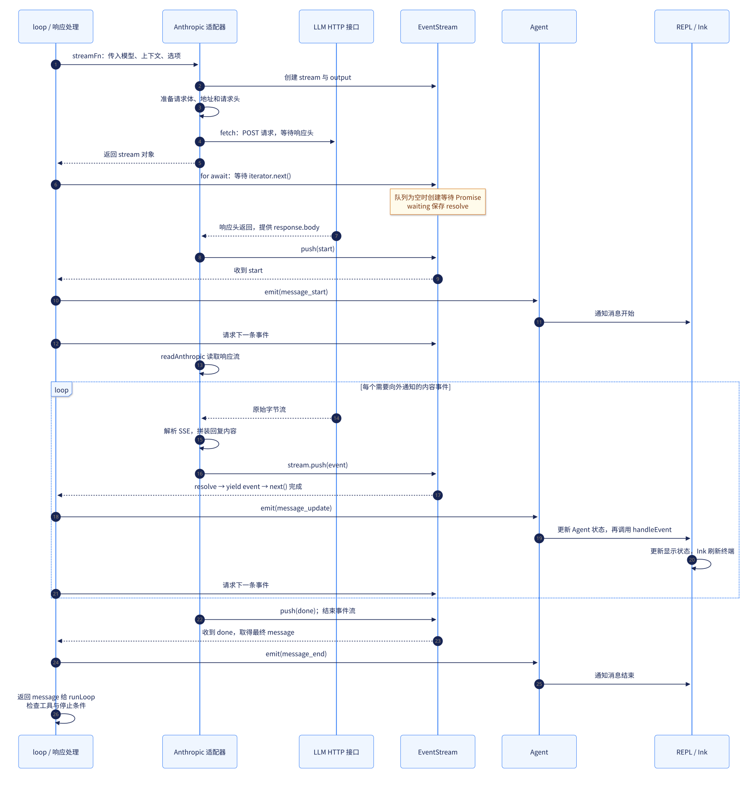

# Main Flow：从按下 Enter 到 Agent 运行结束

本文按当前源码，串起我们讨论的完整主流程：输入框提交 → 第一次 `runAgentLoop` → 请求 LLM → 执行工具 → 携带工具结果再次请求 → 本次运行结束，并说明事件如何到达显示层。

主线以 **TTY 终端、普通聊天输入、默认 Enter 提交**为例。`/help` 等命令在 REPL 内分流；空草稿、忙碌状态、粘贴未完成、反斜杠换行等情况会经过各自的提交判断。

一次 Enter 通常启动一次 `runAgentLoop`。其中的 `runLoop` 可以自动请求 LLM 多次，不需要用户再次按 Enter。一次 LLM 请求及其工具执行，构成这里的一轮 `turn`。

下方三张图用 Mermaid 绘制，并嵌入已渲染的 SVG；图的 `.mmd` 源码和[渲染配置](./assets/main-flow-mermaid.json)保存在 `docs/assets/`，可以随调用关系一起修改。

## 1. 启动时，先把回调接好

还没有按 Enter 时，程序已经完成以下接线：

1. `runCli()` 创建 `Harness`；Harness 内部创建 `Agent`、工具和系统提示。
2. `startTerminalRepl()` 创建 `ReplController`。其构造函数注册显示事件回调：

   ```ts
   this.unsubscribe = this.harness.subscribe(
     event => this.handleEvent(event)
   );
   ```

   `Harness.subscribe(listener)` 调用 `this.agent.subscribe(listener)`，Agent 再执行 `this.listeners.add(listener)`。最终存进去的是 REPL 创建的 `event => this.handleEvent(event)`。

3. 创建 `PromptInputController`，把提交动作接到 REPL：

   ```ts
   onSubmit: draft => { void repl.submit(draft); }
   ```

4. 从 `prompt.target` 取得输入动作处理函数，通过 `dispatcher.configure([inputTarget, global], ...)` 注册给分发器。默认快捷键把 Enter 映射为 `Input` 上下文里的 `input:submit`。
5. 启动终端宿主：

   ```ts
   host = startTerminalHost(
     event => dispatcher.dispatch(event),
     streams,
     cleanup,
   );
   ```

   宿主执行 `stdin.on("data", handleData)`。此后 Node.js 收到终端输入字节时，会调用 `handleData(chunk)`。

启动时的 `banner`、`startupMessage` 是显示文字。进入上述主流程的用户输入由输入框草稿提供。

## 2. Enter 如何走到第一次 runAgentLoop



[查看或修改图的 Mermaid 源码](./assets/main-flow-input.mmd)

### 2.1 字节变成按键事件，分发到提交动作

正常输入走：

```text
stdin 的 data 事件
  → handleData(chunk)
  → parser.feed(chunk)
  → emitEvents(解析得到的事件)
  → onEvent(event)
  → dispatcher.dispatch(event)
```

`parser.feed(chunk)` 把终端字节转换成按键、文字或粘贴等输入事件。`parser.feed(null)` 是 Escape／粘贴等待超时后的处理，普通 Enter 从 `feed(chunk)` 进入。

`dispatch()` 根据快捷键找到 `context: "Input"`、`action: "input:submit"`，从已注册的 target 里取得 handler，再调用 `handler(event)`。

这个 handler 来自 `TextInputController.target.actions`，会调用 `handleAction()`，再进入 `applyAction()` 的 `input:submit` 分支。

### 2.2 提交的是完整草稿

在普通提交分支，TextInput 调用自己的 `options.onSubmit`。它连接到 `PromptInputController` 中的这个回调：

```ts
onSubmit: () => options.onSubmit?.(this.getDraft())
```

这里取出完整的 `PromptDraft`，包括文字、光标、粘贴内容和附件引用，再调用创建 PromptInput 时传入的回调：

```ts
onSubmit: draft => { void repl.submit(draft); }
```

于是进入 `ReplController.submit(draft)`。它会：

1. 检查是否可以提交，用 `preparePromptSubmission(draft)` 展开粘贴文字并收集图片，得到 `text` 和 `images`。
2. 将显示状态设为 `busy`；通过 `onAccept` 重置输入框。已经取得的提交草稿仍供本次请求使用。
3. 识别命令；普通聊天输入走 `await this.harness.prompt(text, images)`。

接下来，`Harness.prompt()` 检查模型和凭据、管理本次操作的取消状态，再进入 `runPrompt()`。有图片时会保存图片并追加路径说明，随后调用：

```ts
await this.agent.prompt(promptText, images);
```

### 2.3 输入内容进入 currentContext

`Agent.prompt()` 先把 `text`、`images` 转成一条 `role: "user"` 的消息，再取得已有上下文快照：系统提示、历史消息、工具。然后通过 `runWithLifecycle()` 启动运行，调用：

```ts
await runAgentLoop(
  messages,                       // 本次新 user 消息数组
  this.createContextSnapshot(),   // 系统提示、历史消息、工具
  config,
  event => this.processEvents(event),
  signal,
  this.streamFunction,
);
```

`runAgentLoop()` 合并本次输入和历史：

```ts
const newMessages: AgentMessage[] = [...prompts];
const currentContext: AgentContext = {
  ...context,
  messages: [...context.messages, ...prompts],
};
```

- `currentContext` 是当前运行使用的完整上下文，后续还会加入助手消息和工具结果。
- `newMessages` 收集本次运行新增的消息，作为 `runAgentLoop()` 的返回值。

输入框里的内容经过这些函数传递、转换，最终作为本次 user 消息进入 `currentContext`。输入草稿里的光标等编辑状态不会进入模型消息。

`runAgentLoop()` 发送 `agent_start`、`turn_start` 和用户消息事件后，进入：

```ts
await runLoop(currentContext, newMessages, config, signal, emit, streamFn);
```

## 3. runLoop 如何自动请求 LLM、执行工具、再请求



[查看或修改图的 Mermaid 源码](./assets/main-flow-loop.mmd)

### 3.1 每一轮都从同一个请求入口开始

`runLoop()` 的主体是 `while (true)`。第一轮的 `turn_start` 已由 `runAgentLoop()` 发送；后续轮次在 while 顶部发送。

每轮都会执行：

```ts
const message = await streamAssistantResponse(
  currentContext, config, signal, emit, streamFn,
);
```

`streamAssistantResponse()` 从当前上下文取出消息，先经过可选的 `transformContext()`，再用 `convertToLlm()` 转成模型消息类型，组装：

```ts
const llmContext: Context = {
  systemPrompt: context.systemPrompt,
  messages: llmMessages,
  tools: context.tools,
};
```

随后解析 API Key，调用 `streamFn(model, llmContext, options)`。默认的 `streamFn` 是 `streamModel`，按 `model.api` 选择 Chat Completions、Responses 或 Anthropic 适配器。

以 Anthropic 为例：

```text
streamModel
  → streamAnthropic
  → streamRequest
      → prepareAnthropicRequest：准备请求体、来源信息和请求头
      → fetch：发起 HTTP 请求
      → readAnthropic：读取并解析响应流，生成统一事件
```

协议的字段和 thinking 校验细节可以在需要时回查；主流程关心的是统一的事件流和最终的 `AssistantMessage`。

### 3.2 拿到本轮 message 后处理工具

`streamAssistantResponse()` 在读取期间更新上下文中的助手消息、发送显示事件。收到最终 `done` 或 `error` 后，发送 `message_end`，将 `finalMessage` 返回给 `runLoop()`。

这个 `return` 只退出 `streamAssistantResponse()`。`runLoop()` 继续执行，将消息加入 `newMessages`，检查错误／取消状态，并筛选消息里的 `toolCall`。

有工具调用时：

- `message.stopReason === "length"`：通过 `failToolCallsFromTruncatedMessage()` 为这些调用生成失败结果，避免执行可能被截断的参数。
- 其他情况：通过 `executeToolCallsSequential()` 处理工具调用。它查找和校验工具，执行工具及前后钩子，发送工具事件，并生成 `ToolResultMessage`。

随后收集这批结果，记录是否允许继续：

```ts
toolResults.push(...executedToolBatch.messages);
hasMoreToolCalls = !executedToolBatch.terminate;

for (const result of toolResults) {
  currentContext.messages.push(result);
  newMessages.push(result);
}
```

工具由 Agent 侧的工具实现执行。模型提出的是工具名称和参数；REPL 接收相关事件，用来显示运行状态和结果预览。

### 3.3 下一次 HTTP 请求如何被触发

结果入上下文后，本轮执行 `emit({ type: "turn_end", ... })`，再调用可选的 `prepareNextTurn()`。这个钩子可以替换上下文、模型或 thinking 配置。随后检查 `shouldStopAfterTurn()` 和 `hasMoreToolCalls`。

没有退出时，执行自然到达 while 末尾，再回到循环顶部。下一次仍然执行同一行 `await streamAssistantResponse(currentContext, ...)`，从而再次发起 HTTP 请求。

这时上下文的内容大致是：

```text
之前的历史消息
user：读取 a.txt
assistant：请求调用 read，调用 ID 为 call_1
toolResult：call_1 对应的文件读取结果
```

下一轮 LLM 因而能看到自己提出的调用及对应结果。它可以继续调用工具，也可以生成最终回答。工具结果通过 `toolCallId` 对应原来的工具调用；适配器负责转换为各协议需要的格式。

### 3.4 结束条件

| 条件 | 当前代码的处理 |
|---|---|
| 本轮模型消息是 `error` 或 `aborted` | 发送 `turn_end`、`agent_end`，退出 `runLoop` |
| `shouldStopAfterTurn()` 返回真 | 发送 `agent_end`，退出 |
| 本轮没有工具调用 | `hasMoreToolCalls` 保持为 `false`，发送 `agent_end`，退出 |
| 工具批次要求终止 | `hasMoreToolCalls` 为 `false`，发送 `agent_end`，退出 |

当前 `shouldTerminateToolBatch()` 的判断是：已收集的工具结果非空，且每个结果都标记 `terminate === true`。工具执行失败可以作为 `isError` 的工具结果交回模型，不一定结束整个运行。

`hasMoreToolCalls` 这个名字在这里表达的是“本轮工具处理后是否继续模型循环”。它并不表示还有一个尚未执行的工具队列；这批工具通常已执行完，下一轮是带着结果再问 LLM。

正常结束的最后一轮通常是：LLM 读取工具结果 → 返回文字回答 → 本轮没有 `toolCall` → 发送 `agent_end` → 退出。

## 4. 流式结果如何到达 loop 和显示层



[查看或修改图的 Mermaid 源码](./assets/main-flow-stream.mmd)

### 4.1 先返回事件流对象，再持续接收数据

Anthropic 的 `streamRequest()` 先创建 `AssistantMessageEventStream` 和 `output`，启动内部异步任务；任务准备请求并执行 `await fetch(...)`。等待 HTTP 响应时，外层返回 `stream`。

因此，loop 中的这句取得的是自定义事件流对象：

```ts
const response = await streamFn(model, llmContext, options);
```

它不需要等整条模型回复生成完成。随后 `for await (const event of response)` 就能开始索取下一条事件。

这里有两个名称相同、用途不同的 `response`：

| 位置 | `response` 是什么 |
|---|---|
| `streamRequest()` 中 `await fetch(...)` 的结果 | HTTP `Response`；其 `body` 是原始字节流 |
| `streamAssistantResponse()` 中 `await streamFn(...)` 的结果 | `AssistantMessageEventStream`；供外层迭代处理统一事件 |

HTTP 响应头返回后，`streamRequest()` 调用 `read(response.body, ...)`。Anthropic 路径中的 `read` 就是 `readAnthropic`：

```text
HTTP 字节流
  → readSse：解析 SSE 消息
  → readAnthropic：解析协议内容、拼装 output
  → stream.push(event)：发送统一的助手消息事件
```

### 4.2 push、Promise 和 yield 的连接

外层 `for await` 会取得 `response[Symbol.asyncIterator]()`，不断调用并等待 `iterator.next()`。

- 如果 `EventStream.queue` 有事件，迭代器直接 `yield` 一个事件。
- 如果没有事件且流未结束，迭代器创建一个 Promise，把它的 `resolve` 存进 `waiting`，并等待。
- `push(event)` 发现有人等待时，调用这个 `resolve({ value: event, done: false })`；否则将事件加入 `queue`。
- 内部 await 恢复后执行 `yield result.value`，完成外层正在等待的那次 `iterator.next()`。
- `streamAssistantResponse()` 的循环体因此拿到 event，继续处理。

这里的 `waiting` 存的是 **resolve 函数**。它服务于消费该 EventStream 的循环；`readSse()` 则在上游读取 HTTP 数据。

时序图展示消费者已经在等待的情况。消费者处理较慢时，生产者仍能 `push`，事件先进入队列，等下一次 `next()` 再取出。

### 4.3 emit 如何到达 REPL

例如 `text_delta`、`toolcall_end` 会在 `streamAssistantResponse()` 中被包装为 `message_update`：

```ts
await emit({
  type: "message_update",
  assistantMessageEvent: event,
  message: { ...partialMessage },
});
```

`emit` 是 Agent 传入的 `event => this.processEvents(event)`。后续路径是：

```text
loop 中 emit(event)
  → Agent.processEvents(event)：更新 Agent 状态
  → 遍历 Agent.listeners，调用注册的回调
  → ReplController.handleEvent(event)：更新显示状态
  → ReplView 通过 useSyncExternalStore 得知状态变化
  → Ink 更新终端显示
```

REPL 在 `message_update` 的 `text_delta` 分支追加 `liveText`；在 `tool_execution_start` 分支添加“工具正在运行”的显示记录；在 `tool_execution_end` 分支显示结果预览。`toolcall_end` 表示模型的工具调用信息已经完整，实际执行由 loop 随后进行。

`message_end` 表示一条消息结束，`turn_end` 表示一次模型请求及其工具处理结束，`agent_end` 表示这次 Agent 运行结束。工具结果本身也会产生消息事件，一次运行可以出现多次 `message_end` 和 `turn_end`。

## 5. loop 结束后，调用如何返回

普通完成路径是：

```text
runLoop return
  → runAgentLoop 返回 newMessages
  → Agent.prompt 的生命周期收尾，清理运行状态
  → Harness 统计用量，按条件处理上下文压缩
  → ReplController.submit 的 finally：整理显示、busy = false
  → 输入框继续等待下一次提交
```

模型最终文字在读取流的过程中就已逐步显示，显示不需要等这些调用全部返回。

Harness 还有上下文溢出的收尾分支：符合条件时先压缩历史，再调用 `Agent.continueFromContext()` 续跑，这会再次进入 `runAgentLoop`。这与 `runLoop` 内部的正常工具续调用是两条不同路径；因此，一次 Enter 在该重试分支中可能启动不止一次 `runAgentLoop`。

## 6. 按调用顺序回查源码

| 源码 | 重点入口 |
|---|---|
| [cli/main.ts](../src/cli/main.ts) | `runCli`：创建 Harness，进入终端 REPL |
| [cli/repl/terminal-repl.tsx](../src/cli/repl/terminal-repl.tsx) | `startTerminalRepl`：创建控制器、连接回调、配置 dispatcher、启动 host；`ReplView` 渲染 |
| [cli/ink/terminal-host.ts](../src/cli/ink/terminal-host.ts) | `startTerminalHost`、`handleData`、`emitEvents` |
| [cli/input/input-dispatcher.ts](../src/cli/input/input-dispatcher.ts) | `configure`、`dispatch` |
| [cli/input/keybindings.ts](../src/cli/input/keybindings.ts) | Enter → `input:submit` |
| [cli/input/text-input-controller.ts](../src/cli/input/text-input-controller.ts) | target 中的处理函数、`handleAction`、`applyAction` |
| [cli/input/prompt-input-controller.ts](../src/cli/input/prompt-input-controller.ts) | 提交回调、`getDraft` |
| [cli/input/prompt-draft.ts](../src/cli/input/prompt-draft.ts) | `preparePromptSubmission` |
| [cli/repl/repl-controller.ts](../src/cli/repl/repl-controller.ts) | 构造时订阅、`submit`、`handleEvent`、`write` |
| [harness/harness.ts](../src/harness/harness.ts) | 创建 Agent、`prompt`、`runPrompt`、`subscribe` |
| [agent/agent.ts](../src/agent/agent.ts) | `prompt`、`normalizePromptInput`、`createContextSnapshot`、`processEvents` |
| [agent/loop.ts](../src/agent/loop.ts) | `runAgentLoop`、`runLoop`、`streamAssistantResponse`、工具执行 |
| [llm/adapter.ts](../src/llm/adapter.ts) | `streamModel` 的协议选择 |
| [llm/protocol-utils.ts](../src/llm/protocol-utils.ts) | `streamRequest` 的请求、事件流和结束处理 |
| [llm/anthropic.ts](../src/llm/anthropic.ts) | 请求准备和响应事件转换，以 Anthropic 为例 |
| [llm/sse.ts](../src/llm/sse.ts) | 原始字节到 SSE 消息 |
| [llm/event-stream.ts](../src/llm/event-stream.ts) | `push`、队列、`waiting`、异步迭代器、`result()` |
