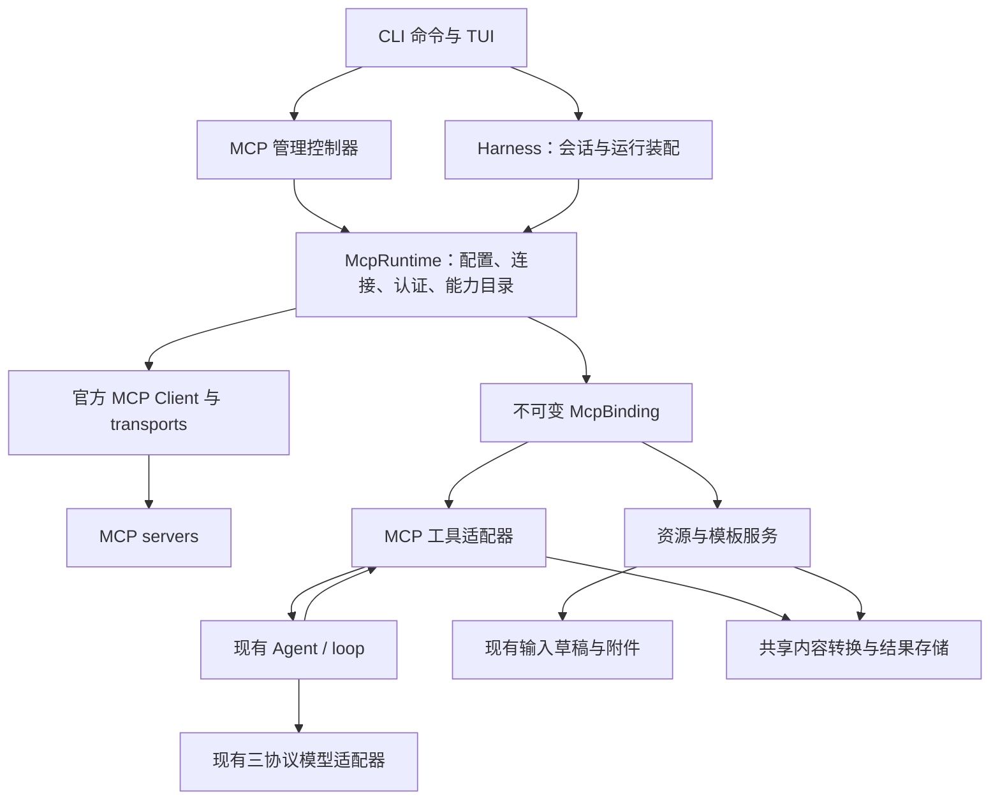

# MCP 接入设计与三块实现计划

截至 2026-11-18，三个功能块均已实现。服务器管理使用锁定的 `@modelcontextprotocol/client@2.4.0`。Harness 在每次用户提交时把绑定的服务器工具装入 Agent，CLI 提供资源读取和提示模板草稿入口。测试环境与结果见 [开发进度](./progress.md)。

## 1. 目标与范围

Anti-trace 作为 MCP Host，通过客户端连接本机 stdio server 或 Streamable HTTP server，将 server 提供的 Tools、Resources、Prompts 接入现有会话。业务操作由 server 执行，Agent 负责选择、校验、授权、调用和结果回传。

Skill 是任务说明与工作流程，可以使用本地或远程工具；MCP 是发现和调用外部能力的协议，server 也可以在本机。两者不按本地／远程划分。本计划不实现 Skill 系统。

三个实现块的最终范围：

| 功能块 | 完整交付的用户能力 | 主要输入 → 输出 |
|---|---|---|
| 一：服务器接入与管理 | 配置、信任、连接、认证、目录查看、重连、停用、清理 | server 配置 → 可管理的真实连接与能力目录 |
| 二：模型调用 MCP 工具 | 模型发现并调用工具，审批、进度、结果、错误、取消与历史显示 | server 工具目录 → `AgentTool[]` → 对话中的工具结果 |
| 三：Resources 与 Prompts | 按需读取资源、将资源和提示模板加入草稿 | URI／模板与参数 → 有来源的可编辑上下文 |

三块不要求等量工作。连接、认证、目录和生命周期紧密相关，集中在第一块完成，避免第二块、第三块回头更换连接框架。

本轮范围不包含：把 Anti-trace 暴露为 MCP server、mcpo/OpenAPI 转换、旧 HTTP+SSE 专用 transport、WebSocket 自定义 transport、插件市场、工具搜索／延迟加载、sampling、elicitation、任务扩展、MCP Apps、资源内容持续订阅、配置文件自动监听。它们不以空实现或假能力提前注册。

## 2. 实施约束

- 每块交付该块功能的最终实现和真实入口；不编写下一块才会替换的客户端、临时工具、假数据、固定成功结果或 mock server。
- 不安排“中间验证阶段”，不为拆批加入 mock 或测试脚手架。完整功能完成后再集中进行必要验证；沿用现有正式测试体系，不将本计划理解为删除测试或永久取消质量检查。
- 在文档中先定好跨块契约；代码中的方法在所属块才落地，并完成真实行为。第一块的客户端协议操作本身就是服务器管理功能，不依赖模型调用才成立。
- 后续块可以在已列出的装配位置新增 import、工具来源或命令注册；不重写上一块核心实现。这里约束的是避免过渡设计，并非承诺同一个文件永远不再增加一行。
- 发现必须改变已定契约时，先说明具体冲突并更新设计，再调整实现；不以“下一轮再补”为理由留下错误语义。
- 三块分别更新本文件的完成状态及 `progress.md`；代码未完成前，架构书和 README 不把 MCP 写成已具备能力。

## 3. 整体架构

职责规则：

1. `src/mcp/` 处理 MCP 协议、运行期状态、目录和内容。SDK 类型停留在这一层，不进入 Agent、LLM adapter、React 状态和 JSONL。
2. Harness 创建并持有一个 `McpRuntime`；CLI 获得管理接口，但不另建连接。Runtime 不持有模型、聊天消息、终端或 React 组件。
3. Agent / loop 保持通用工具执行职责。MCP 工具与 `read`、`bash` 等使用同一条校验、审批、事件和结果配对链。
4. 模型适配器负责已有协议编码。MCP 不要求更换模型协议、不新增模型厂商专用的 MCP 调用通道。
5. Runtime 存活于 Harness 生命周期；`/new` 和 `/resume` 保留连接，清空会话级授权。恢复历史不执行历史工具，不从历史重新启动 server。
6. CLI 创建的 Harness 由 `runCli()` 在最外层 `finally` 中等待关闭；嵌入者传入的 Harness 由嵌入者管理，避免关闭不属于 CLI 的资源。

## 4. 模块与跨块契约

目录按职责划分，不建立通用插件框架：

| 模块 | 职责 | 所属块 |
|---|---|---|
| `src/config/mcp.ts` | 读取、校验、合并配置，来源与覆盖信息，原子保存 | 一 |
| `src/mcp/types.ts` | 无 SDK 依赖的配置、状态、目录、调用、内容契约 | 一 |
| `src/mcp/runtime.ts` | server 集合、配置应用、管理接口、binding 与生命周期 | 一 |
| `src/mcp/connection.ts` | 单 server 连接、版本选择、请求、接收大小限制、超时、取消、关闭 | 一 |
| `src/mcp/http.ts`、`stdio-launch.ts`、`stdio-host.mjs`、`util.ts` | HTTP 有界接收、stdio 进程所有权、共享任务及运行限制 | 一 |
| `src/mcp/catalog.ts` | Tools／Resources／Templates／Prompts 元数据、分页、修订与失效 | 一 |
| `src/mcp/auth.ts`、`local-state.ts` | HTTP 认证、凭据、项目信任和本机启停覆盖 | 一 |
| `src/cli/commands/mcp-command.ts` | `/mcp` 参数命令与服务器管理菜单 | 一 |
| `src/mcp/tool-source.ts`、`tool-names.ts` | 工具来源适配、稳定名称、模型可见定义与调用绑定 | 二 |
| `src/mcp/content.ts`、`output-store.ts` | MCP 内容归一化、截断、图片／文件保存与来源信息 | 二 |
| `src/tui/tools/McpToolView.tsx` | MCP 工具进度、结果、来源和附件显示 | 二 |
| `src/mcp/resource-source.ts` | 资源目录／读取工具与用户资源读取入口 | 三 |
| `src/mcp/prompt-service.ts` | 获取模板、参数检查、转为可编辑草稿材料 | 三 |
| `src/cli/commands/mcp-context-command.ts` | `/mcp-resource`、`/mcp-prompt` 与草稿插入 | 三 |

使用现有 `CommandDialogController`、输入焦点和展示组件实现管理菜单；确有需要再增加 `src/tui/mcp/` 组件，不创建第二个 stdin 读取器。

第一块的公共契约一次确定并真实实现：

| 契约 | 输入／输出及约束 |
|---|---|
| `McpRuntime.getSnapshot()` / `subscribe()` | 只读的脱敏 server 状态、配置来源、能力、目录状态及诊断 |
| `reload()` / `save(scope, id, value, expectedDigest)` | 校验配置后发布有效配置；保存检测外部修改并原子写入，错误候选不替换旧配置 |
| `connectServerAndDiscover(serverId, signal)` | 一个 server → 连接结果和工具目录；其余目录按管理请求加载 |
| `reconnect / setEnabled / trust / login / logout` | 显式服务器管理操作；配置变更与调用不能相互偷换身份 |
| `acquireBinding(signal)` | 等待本轮启用且受信任的 server 的有界连接尝试 → 目录与连接绑定；单 server 失败不让全部失败 |
| `McpBinding` | 保存 `serverId → ServerBinding` 的只读映射；每个 ServerBinding 固定连接 generation、配置／授权身份、能力和工具目录 revision；整个 binding 提供 `release()` |
| binding 的协议操作 | 显式指定 server 的 `listTools`、`callTool`、`listResources`、`listResourceTemplates`、`readResource`、`listPrompts`、`getPrompt`；返回项目定义的 DTO，接收 `signal`、超时和进度回调 |
| `McpRuntime.close()` | 幂等关闭，取消等待／认证／请求，释放订阅和进程，等待清理完成 |

不支持的 server capability 返回明确的“不支持该操作”，不以空目录伪装成功。正常的空目录与失败分开表示。绑定失效、认证缺失、取消、超时、协议错误分别保留错误类别，展示文字不夹带凭据。

Tools 在 binding 创建时固定目录；按需读取的 Resources／Templates／Prompts 在本 binding 首次使用该目录时取得完整快照，随后固定该目录 revision。只有被消费的目录参与对应操作的失效判断。所有操作始终绑定同一 server 身份和连接 generation；新增一个目录快照不能换掉连接。调用结束或取得工具来源中途失败时，所有已取得的 binding／source 必须在 `finally` 释放。

第二块新增且一次完成的宿主契约：

- `ToolSource.acquire(runContext, signal)` 返回本轮 `tools`、带来源的 `instructions` 与 `release()`。`HarnessOptions.toolSources` 用于装配来源，现有内置工具保留原工厂。第二块传入 MCP tool source；第三块新增 resource source，仅增加装配项。
- `runContext` 携带已取得的同一份 MCP binding、当前模型能力和本次输出存储位置。资源工具与 server 工具不得各自连接或各取一份不一致的 binding。
- `AgentToolResult.isError?: boolean` 表达正常返回的业务错误；loop 原样传入最终 `ToolResultMessage.isError`。
- `AgentTool` 增加可选的权限身份解析入口：对已经校验的参数返回 `provider / scopeKey / actionKey / label`。loop 把结果放入 `BeforeToolCallContext`；`PermissionPolicy` 根据身份处理会话授权。现有内置工具未提供该入口时保持当前规则。
- `scopeKey` 绑定 server 配置和当前授权身份，`actionKey` 绑定实际操作及目标定义。第二块工具使用原始工具名和定义摘要；第三块资源工具使用 server 与实际 URI，因此不需要重写权限机制。
- MCP 调用的结果详情采用带 `kind: "mcp"` 的版本化可序列化结构，包含来源、耗时、状态、截断及附件引用。实时卡片与历史恢复使用相同结构。

## 5. 功能块一：服务器接入与管理

主流程：`connectServerAndDiscover()`。完成后用户不需要配置模型，就能管理真实 MCP server，检查工具定义、能力和错误。

### 5.1 配置与信任

已合入统一存储：上述用户路径由 `getAppPaths()` 计算，随 `ANTI_TRACE_HOME`／`appHome` 与 `profileId` 改变；项目共享配置固定为当前 cwd 的 `.anti-trace/mcp.json`。会话沿用远端的 profile／project 目录，不另设 `~/sessions`。

固定三处配置／状态位置：

- 用户配置：`~/.anti-trace/profiles/local/mcp.json`。
- 项目配置：当前工作目录 `.anti-trace/mcp.json`，可共享；本计划定义自身字段，不承诺所有其他客户端扩展字段都兼容。
- 用户私有状态：`~/.anti-trace/profiles/local/mcp/`，保存项目信任、本机启停覆盖和凭据；不写入项目 JSONL。

同名 server 采用项目整条配置覆盖用户配置，不拼接 command、args、headers 或 auth。管理界面显示生效来源与被覆盖来源。项目配置按当前工作目录读取，不向父目录递归搜索；相对路径相对于配置文件目录解析。

文档格式为 `{ "version": 1, "mcpServers": { ... } }`；导入时接受省略 `version` 的常见 `mcpServers` 容器，保存时规范化。stdio 可省略 `type`，HTTP 必须明确 `type: "http"`。未知字段报可定位的配置诊断，不默默丢弃。

| 字段组 | 固定语义 |
|---|---|
| 公共 | `enabled`（默认 true）、`startupTimeoutMs`（默认 10000）、`requestTimeoutMs`（默认 60000）；版本策略不作为用户配置字段 |
| stdio | `command`、`args`、`cwd`、`env`、`envVars`；env 保存非敏感固定值，凭据经 envVars 引用本机环境；按可执行文件和参数数组启动，不拼接 shell 命令 |
| HTTP | `url`、`headers`、`envHeaders`、`auth`；headers 保存非敏感固定值，凭据引用环境变量，Authorization 来源只能有一个 |
| auth | 无认证、`bearer`＋环境变量名、`oauth`＋可选 client ID／secret 环境变量、scopes／回调端口；三种互斥 |
| 工具筛选与输出 | `enabledTools`（可选白名单）、`disabledTools`（最后生效），按 server 原始工具名匹配；`outputMaxBytes`（默认 32768）限制每次工具／资源／模板交给模型的文本总量 |

第一块就完整解析这些字段；连接和目录配置立即生效，工具筛选同时限制 binding 调用。`outputMaxBytes` 作为 binding 上的有效输出策略，由第二块的内容转换器消费，不先实现临时截断。后两块不再给 transport 配置补认证分支。

配置文件缺失视为空配置；JSON／字段错误保留上次生效快照。合法配置中的连接失败只影响该 server。文件编辑成功但无法联网时保留新配置并展示连接错误，不把网络可达性作为保存条件。

用户主动设置的用户配置作为本机信任来源；项目配置必须显式信任后才启动命令、发送连接请求或进行 OAuth 发现。信任绑定规范化项目位置、配置来源及影响执行／访问目标的配置指纹。修改 command、args、cwd、URL、header／env 配置或认证方式需要重新信任；单纯调整超时不撤销信任。

`--yolo` 只控制模型工具调用审批，不自动信任新项目配置。管道模式不弹信任／登录界面；通过 `/mcp trust <server>` 等明确管理命令完成授权。连接批准不等于批准该 server 的所有业务工具。

### 5.2 连接、协议与认证

采用官方 TypeScript 客户端 SDK，锁定版本及依赖锁文件。JSON-RPC 编解码、协议版本处理、标准 transport、OAuth 协议流程交给 SDK；应用实现持久化、交互和生命周期。

版本策略（2026-11-16 用户确定）：stdio 和 HTTP 都通过 SDK 自动探测新版协议；支持新版时使用新版，确认不支持时使用旧版。使用 `versionNegotiation: { mode: "auto" }`，为探测设置有界期限；按 SDK 的协议响应和 stdio 探测超时规则判定兼容回退；网络、HTTP 探测超时和认证失败不由应用层捕获后强行重试旧版。探测和正式连接共用启动总期限，Agent 不接触 initialize／discover 的区别。界面只显示实际协商的协议版本，不提供 legacy／modern 选择。

stdio 使用最小系统环境和显式转发变量，保留各平台运行可执行文件所需的 PATH／HOME／Windows 系统变量；不整包继承模型 API key。stderr 单独收集并有界显示，不能写入 Ink stdout。Windows 命令解析与进程树退出在这一块处理完整，不借 `bash.execute()` 代管 MCP。

stdio 的每次 SDK 探针及正式连接分别持有进程所有者：POSIX 使用独立进程组；Windows 由系统 Windows PowerShell 启动器先将自身加入 kill-on-close Job Object，再启动 Node host 及服务器，避免 SDK 立即终止探针启动器时留下后代。启动器只执行静态脚本，配置参数通过环境中的 JSON 传入 Node，随后移除内部变量。若系统禁止 PowerShell／Add-Type 或 Job 绑定，连接报错；不降级为无法保证清理的启动方式。Windows stdio 探针期限为 5 秒（包含启动器启动时间），其余探针为 2 秒，均受服务器 startupTimeoutMs 总期限限制；Windows 实机验证边界见文末。

HTTP 支持无认证、Bearer 和 OAuth。OAuth 包含 SDK 支持的发现／注册、预注册 client、PKCE、回调、保存和刷新；登录由明确 `/mcp login` 操作触发，连接或工具调用遇到需要交互的认证时进入 `needs-auth`。已有同一授权的自动 token 刷新可以继续；需要重新同意或新增 scope 时交还用户。

连接接收层在第一块就实施协议消息体、单行 stdio 帧、HTTP JSON／SSE 事件、stderr 和目录元数据的大小上限，集中定义为运行限制。优先使用 SDK 的限制选项，缺失时在 transport／fetch 边界实施有界读取，不能由后续显示层替代。达到限制时中止受影响操作并报告原因；第二块只消费已受限的 DTO，不再补改连接读取机制。

凭据存于用户私有文件，采用原子写入及平台用户权限；该文件不声称加密保险库。持久化键包含 endpoint 和 OAuth client／授权身份，防止同名 server 复用另一端点凭据。共享配置通过环境变量引用提供凭据；管理界面、状态诊断、日志、tool details、session 和模型输入不回显 token、client secret 或原始 Authorization header。登录／退出切换授权身份会使旧 binding 与会话授权失效；同一授权的正常 token 刷新不撤销项目信任。

支持 roots 时只暴露明确的项目根目录并使用正确 file URI；roots 不是文件系统沙箱。未实现的 sampling、elicitation、tasks 不声明支持；对需要额外输入的协议结果返回明确的能力诊断，不伪装成普通成功结果。

### 5.3 状态、目录与生命周期

运行状态使用 `disabled / untrusted / disconnected / connecting / ready / needs-auth / failed / closing`。连接状态与目录状态分离：握手／发现成功但 tools/list 失败时，显示“已连接，工具目录失败”，不把它显示为没有工具。

启动 Harness 仅创建 Runtime；首次管理操作按需读配置，不等待网络。用户主动连接或查看远端目录时，才连接已启用且受信任的 server；第二块将让实际模型任务通过 acquireBinding 连接。连接任务去重并限制并发，每个 server 有独立启动期限；一个失败不阻止其他 server、聊天或 `/new`、`/resume`。

首个 connect 获取 Tools 目录；Resources、URI templates、Prompts 目录在用户查看时加载，按 capability 决定是否请求。所有 list 操作处理分页、重复 cursor 和目录数量／大小上限；目录请求失败不得留下“成功但只有半页”的新快照。没有完成首次获取时标记未加载，不显示猜测数量。

工具、资源和提示目录变化通过 SDK 的对应协议机制接收；失效后合并刷新请求，避免通知风暴。完整新目录取得后发布 revision。当前绑定使用旧目录时，受影响的操作返回 `catalog-changed`，不默默用新定义执行；未受影响目录的调用仍可继续。

连接 generation 在重新连接时改变。不自动重放已经发出的 `tools/call`，因为断线时不能推断业务是否已执行。断线后标记状态，下一次明确连接／新任务可重新建立连接；一个操作内避免无限重连。目录读取可做有界重试，业务调用的恢复由模型／用户在看到结果后决定。

Ctrl+C 取消当前请求／准备工作，不默认关闭仍健康的共享连接。退出时停止接收新操作，取消全部在途工作和 OAuth 回调，关闭 transport，并等待 stdio 子进程及其应归属的后代退出；超过清理期限按平台终止。`close()` 可以多次调用，旧 generation 的迟到事件不能覆盖当前状态。

配置重载、停用、重新信任、登录和主动重连在宿主空闲时执行；运行期自然发生的断线／目录失效由 binding 检查处理，不在执行中替换模型看到的目录。

### 5.4 真实用户入口与完成边界

`/mcp` 在 TTY 中打开服务器管理菜单，在管道中等价于 `list`；显式参数包括：`list`、`status [server]`／`show <server>`、`tools/resources/templates/prompts <server>`、`add`、`edit/delete <server>`、`connect <server>`、`reconnect <server>`、`enable/disable <server>`、`trust <server>`、`login/logout <server>`、`reload`。纯管道不启动交互式 OAuth 登录；`login` 在该模式下说明需要交互入口，项目配置的显式信任和新增／编辑／删除表单也需要 TTY；查看、连接、重载和启停可用于管道。

菜单支持配置新增／编辑／删除、来源查看、能力目录浏览、信任、登录与连接操作；新增时选择“当前项目”（默认）或“所有项目”，分别保存到项目和用户配置。编辑写回原来源，删除项目覆盖项时明确提示用户同名项会重新生效；普通编辑通过字段表单，数组／映射字段用 JSON 值编辑并在保存前校验。启停覆盖写入用户私有状态，不擅改项目共享文件。凭据字段显示引用或掩码。

本块同时实现 binding 的 `callTool/readResource/getPrompt` 等真实协议操作，供之后的应用适配层消费；管理界面不提供绕过正常工具审批的任意执行按钮。

涉及已有文件：`main.ts` 的统一清理和装配，`harness.ts` 的 Runtime 所有权与管理接口，`command-registry.ts`、`repl-controller.ts` 的 `/mcp` 路由，终端装配／语言字典／必要界面；依赖、配置示例与用户文档随本块同步。

完成边界：可在没有模型配置时管理真实 server、查看工具定义、完成登录和故障恢复，退出后连接与进程正确清理。此时尚未给 LLM 注册 MCP 工具；管理界面始终只报告 server 连接与目录状态，不把连接成功等同于模型调用成功，也不增加下一块需要删除的临时功能提示。

## 6. 功能块二：模型调用 MCP 工具

主流程：`McpToolSource.acquire()`。第一块接口保持不变；本块一次补齐工具定义、执行、权限、结果和显示。

### 6.1 目录进入 Agent 的流程

1. Harness 在实际用户提交时校验模型／凭据，随后取得本轮 MCP binding；准备工作使用当前 prompt 的 AbortSignal。
2. Tool source 将允许且兼容的远端工具转换为 `AgentTool`。内置工具和外部工具一起构成模型目录；工具筛选不改变原始 server 目录。
3. 同时构建带来源的 server instructions，限制长度并与核心提示分隔；外部说明不成为可覆盖宿主规则的指令来源。
4. 模型请求、参数校验、权限判断、执行句柄和结果显示使用同一份定义及身份。本次 `prompt()` 的所有工具续接与溢出恢复共享该 binding。
5. prompt 结束后释放绑定。下一次提交取得新目录；活跃运行不响应目录变化而直接改写工具数组。

名称采用模型可接受的 ASCII 字符集、总长不超过 64 字符。使用 `mcp__<server>__<tool>` 可读前缀，必要时截断，并附由原始 server ID／工具名确定的摘要；对最终名称再查重，摘要碰撞时禁用冲突项并诊断。名称稳定且不依赖目录返回顺序。内部保存显式映射，执行和权限不靠 split 名称定位 server。

远端 JSON Schema 在注册时检查有效性、引用范围和大小。复用当前 TypeBox 1.x 的 JSON Schema 校验能力；不为了接入 MCP 全面重写内置工具类型。外部引用不自动联网加载；支持的本地引用需要按既定规则解析。模型不兼容的 schema 显式隔离并说明，不能静默删除约束再假装等价。

首版所有允许工具直接列入模型 tools，默认顺序执行；本轮不加入工具搜索、模型专有 `defer_loading` 或自动并行。目录变化同步更新系统工具列表和上下文统计；当前代码的 request key 已包含工具定义，应保留该行为。仅工具定义已超出窗口预算时，在发模型请求前说明需要减少启用工具，不进行无效的反复历史压缩。

### 6.2 执行与权限

保持现有链路：查找工具 → 参数校验 → 解析权限身份 → `beforeToolCall` → `execute()` → `afterToolCall` → 执行事件与 `toolResult`。

`execute()` 使用绑定的原始工具名调用 `tools/call`，传递取消、期限和进度回调。权限通过后、请求发送前再次检查 binding 有效性；期间配置或目录变更不能把已批准操作替换成另一个操作。

补齐现有的两个具体缺口：

- `AgentToolResult` 增加 `isError`；`loop.ts` 中正常返回路径由固定 `isError: false` 改为读取结果标记。MCP 业务失败保留内容，传输／协议异常仍进入错误路径。
- `PermissionDialog` 不再把所有非 shell 工具的会话授权写成“允许所有文件编辑”；`PermissionPolicy` 记录外部操作身份并显示“本会话允许此工具”。

权限模式固定为：`default` 和 `auto-edit` 都要求 MCP 业务调用授权；`auto-edit` 仅放开现有本地编辑。`yolo` 免单次调用审批，但不越过 server 信任、显式工具禁用和认证。非交互模式没有可用授权时明确拒绝。`readOnlyHint` 用于说明，不单凭 server 的自报信息放行。

会话授权键包含 server 配置／授权身份及工具定义摘要。`/new`、`/resume` 清空会话授权；重新配置、重新登录或工具定义改变后旧授权不可继续使用。连接重建但身份和定义未变时，可以保留同一会话授权。

### 6.3 内容、存储与历史

第二块一次实现共享内容转换器，第三块直接复用：

| MCP 内容 | 最终处理 |
|---|---|
| text | 保留文本，按统一预算截断 |
| image | 校验 MIME／编码／大小，支持的格式进入现有 ImageContent；模型不支持时提供附件说明 |
| structuredContent | 进入可读 JSON 内容，避免与已有等价文本重复；不能只放进模型看不到的 details |
| resource link | 保留来源 server、URI、名称和 MIME；不自动发起读取 |
| embedded resource | 作为已返回内容转换，不因 URI 再次读取 |
| audio／其他二进制 | 保存附件与类型说明；没有音频能力时不声称模型已听到内容 |
| 未知内容类型 | 返回明确的不支持说明，保留有界诊断，不把整个调用伪装成空结果 |

模型可见文本采用总量预算，初始默认 32 KiB，并允许按 server 配置调整；图片／二进制另设展示与存储总量上限。第一块的接收限制继续生效。大但在接收上限内的完整内容写入 `~/.anti-trace/profiles/local/projects/<项目ID>/tool-results/mcp/`，模型收到摘要和路径；超过接收上限时明确报告未保存完整结果。

存储文件由宿主生成名称，URI 不用作本机目标路径。已完成结果文件允许保留供后续 read；取消期间不把半份文件标成完整结果，保存失败不得返回不存在的路径。认证元数据不写入结果存储。复用 shell 输出的预算思想，不把 `BashOutput` 变成不适合结构化内容的通用流容器。

提供 `McpToolView`，显示 server、工具、参数、耗时、进度、错误和附件；复用既有执行事件及卡片容器。JSONL 保存已归一化的实际内容和必要来源，恢复历史不需要 server 在线。异步迟到进度在结果完成后被忽略，取消继续满足现有“一次 toolCall 必须配一条 toolResult”的要求。

涉及已有文件：`types.ts`、`agent/loop.ts`、`harness/harness.ts`、`harness/prompt.ts`、权限策略与弹窗、transcript 投影与工具显示、模型能力／结果编码的必要适配；三协议调用框架不重做。

完成边界：用户能让实际模型调用 stdio 或 HTTP 工具，审批、取消、错误和图文结果正确，切会话不丢连接、恢复记录不重放操作。资源和提示模板继续保持独立功能边界。

## 7. 功能块三：Resources 与 Prompts

两个主流程：`readMcpResource()`、`prepareMcpPromptDraft()`。它们共用第一块的 binding 和第二块的内容转换、权限与存储，新增应用入口，不改连接实现。

### 7.1 Resources

增加通用工具 `mcp_list_resources`、`mcp_read_resource`，由一个新的 `ToolSource` 接入。参数包含显式 server 标识；读取参数包含 URI。能力目录与资源内容分开获取，不把所有资源预读进上下文。

资源列表返回普通资源和 URI template 的元数据。URI template 使用符合 URI Template 规则的展开方式，不以字符串替换代替编码；可以直接指定完整 URI 读取，不要求它一定出现于资源列表。

资源 URI 属于对应 server 的地址空间，`file://` 不代表本机文件；读取始终调用所选 server 的 `resources/read`，不切换成本地 `read` 或任意 HTTP 抓取。权限通过第二块的参数相关身份入口绑定 server 和具体 URI；不是只批准一个可读取所有 server 的通用工具名字。

用户入口 `/mcp-resource` 提供服务器／资源／模板选择、参数填写、预览和加入草稿；TTY 中读完不自动调用模型，用户可编辑后提交。显式 `/mcp-resource <server> <uri>` 在管道中输出有界内容与来源。目录变化沿用 Runtime 的失效机制；不自动改写已经进入聊天的资源快照。

### 7.2 Prompts

用户入口 `/mcp-prompt`：选择 server → 选择模板 → 根据 `prompts/list` 的参数说明填写 → `prompts/get` → 预览 → 插入草稿。显式参数形式为 `/mcp-prompt <server> <name> <JSON参数对象>`，参数值按协议要求为字符串；缺参在调用前说明。

产品行为固定为“模板材料进入用户可编辑草稿”，不直接执行工具或自动发送模型请求。返回的多条 user／assistant 模板消息按顺序转换：user 内容进入正文，assistant 内容以明确标记的示例／预期回答片段进入正文；保留原始模板包供查看，不伪造模型过去真实回答过的消息，也不承诺 provider-specific assistant prefill。

文本、图片、嵌入资源通过第二块内容转换器成为现有草稿的文本／图片附件；resource link 只加入引用，另行读取需用户或模型明确操作。模板输出不写入 system 层。纯管道命令输出展开后的模板材料，不自动进入聊天。

不为每个远端 prompt 动态注册一个顶层斜杠命令，避免名称冲突和修改现有静态命令类型；统一从 `/mcp-prompt` 选择。

### 7.3 草稿、会话与完成边界

复用当前 `PromptDraft` 的文本／图片引用，不新增“远程附件稍后偷偷解析”的状态。读取完成后固定内容，并在正文附 server、URI／模板名、参数和获取时间等必要来源；参数按用户实际提交保留，连接凭据不进入草稿。取得内容失败或取消时，原草稿保持不变。

向输入层增加一个明确的草稿插入动作，按一次编辑事务支持撤销；插入过程中若草稿已被用户改动，采用提交时 revision 校验，保留用户新内容而不覆盖。当前输入的清理只由已有接受提交流程负责，MCP 获取失败不吞掉草稿。

新增两个命令的注册和路由、一个 resource tool source 装配项、草稿插入回调及必要翻译。第一块 `/mcp` 管理逻辑、第二块权限和 loop 不为本块重写。提交后继续使用现有 UserMessage／ImageContent、会话保存与上下文压缩；压缩后不自动重新抓取远端内容。

完成边界：模型能按需读资源；用户能在无模型配置时浏览／获取资源与模板，随后配置模型并提交草稿。三类 MCP 能力分别通过工具调用、资源读取、模板选择发挥作用。

## 8. 防止返工的具体约束

| 提前一次完成的事项 | 放在哪块 | 后续如何扩展 |
|---|---|---|
| stdio＋HTTP、版本策略、认证、进程与请求生命周期 | 一 | 后续只调用 binding，不另建 SDK client |
| 四类目录、分页、capability 判断、失效与修订 | 一 | 后续添加消费者，不改变目录所有权 |
| 配置来源、项目信任、凭据身份 | 一 | 工具与资源使用相同 server 身份 |
| 工具来源装配与每次提交快照 | 二 | 第三块仅新增 resource tool source |
| 正常返回的业务错误与取消配对 | 二 | 后续返回同一种结果，不再改 loop |
| 按实际操作解析权限身份 | 二 | 第三块按 URI 使用，不改权限 UI 的基本模型 |
| 所有 MCP 内容类型的归一化、文件存储和来源 | 二 | 第三块转换资源／模板内容后直接复用 |
| prompt 作为可编辑材料而非原生预填消息 | 三 | 三个模型协议共用现有输入，不改消息角色体系 |

## 9. 完成后的集中验证范围

第一块于 2026-11-16 在 macOS／Node 24 验证了 stdio、回环 HTTP／OAuth、菜单和 CLI 子进程。三个功能块集成后于 2026-11-18 在 Windows／Node 24 验证，并使用两个真实模型完成工具调用。各轮覆盖的平台与账号范围见 [开发进度](./progress.md)。

三块完成后统一核对：无模型仍能管理 server；合法配置与坏候选的行为；本机 stdio 和远程 HTTP／OAuth；分页、目录失效、名称冲突与 schema 隔离；三模型协议的工具结果；业务失败与传输失败；审批和会话授权隔离；取消后调用结果配对；长结果和附件；资源 URI 与模板草稿；切会话／恢复历史；退出及 Windows／Linux／macOS 进程清理。

优先使用明确配置的真实 MCP server 和项目既有正式检查。任何真实账户、模型或平台尚未覆盖都记录边界，不用假返回宣称通过。第一块的正式测试位于 tests/：本机子进程协议服务与 loopback HTTP／OAuth 服务仅用于验证协议交互，不作为产品代码或过渡层；未使用真实账户凭据。

## 10. 参考实现与取舍

- 本机 Claude Code 恢复源码 `claude-code-rev@3b0498a`：`src/services/mcp/client.ts` 的连接、工具包装和调用；`useManageMCPConnections.ts` 的目录变化；`config.ts` 的来源管理。参考动态工具包装，避免将 React hook 作为本项目连接的所有者。该仓库包含恢复补丁，不视为当前官方完整实现。
- [Codex McpRuntime](https://github.com/openai/codex/blob/main/codex-rs/codex-mcp/src/runtime.rs) 与 [McpBinding](https://github.com/openai/codex/blob/main/codex-rs/codex-mcp/src/binding.rs)：借鉴运行期所有权、绑定和目录一致性，不复制其完整插件／远程执行器体系。
- [MCP TypeScript SDK](https://github.com/modelcontextprotocol/typescript-sdk) 与 [版本选择](https://github.com/modelcontextprotocol/typescript-sdk/blob/main/docs/protocol-versions.md)：协议差异由客户端层处理；当前 v2 包为 `@modelcontextprotocol/client`，实施时锁定核对过的具体版本。
- [MCP Resources](https://modelcontextprotocol.io/specification/2026-07-28/server/resources) 与 [SDK Prompts](https://github.com/modelcontextprotocol/typescript-sdk/blob/main/docs/servers/prompts.md)：资源按 URI 获取、模板按参数展开；草稿交互和角色呈现是 Anti-trace 的产品选择。

上述外部来源核对于 2026-11-16；链接中的 main 会变化，实施记录需补充实际采用的依赖版本与源码版本。
